<div align="center">

# Particle Life

**A 2D particle ecosystem simulated and rendered entirely on the GPU with WebGPU.**
Minimal attraction/repulsion rules between species → cells, snakes, flocks, vortices and spiral waves.

[](https://github.com/jossseluuu/particleLife/actions/workflows/deploy.yml)
[](https://jossseluuu.github.io/particleLife/)
[](https://www.w3.org/TR/webgpu/)
[](tsconfig.json)
[](https://jossseluuu.github.io/particleLife/docs/)
[](LICENSE)

**[▶ Open the demo](https://jossseluuu.github.io/particleLife/)** · **[📚 Documentation (ES)](https://jossseluuu.github.io/particleLife/docs/)** · [Español](README.md) · [Contributing](CONTRIBUTING.md)

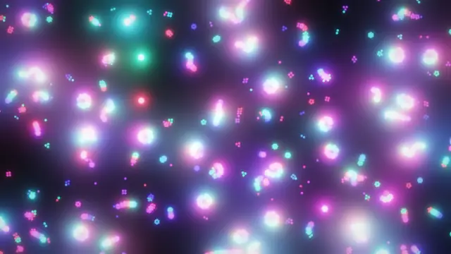

</div>

> The app interface and most documentation are in Spanish; this page is a full English overview.

## What it is

Each color is a **species**. Each species is attracted to or repelled by the others according to an
**interaction matrix** — and the matrix is *asymmetric*: A chasing B doesn't mean B chases A.
Breaking Newton's third law produces structures that move, split and hunt each other as if they were alive.

This project pushes the idea in the browser: up to **one million particles** in real time, everything editable while it runs.

<p align="center">
  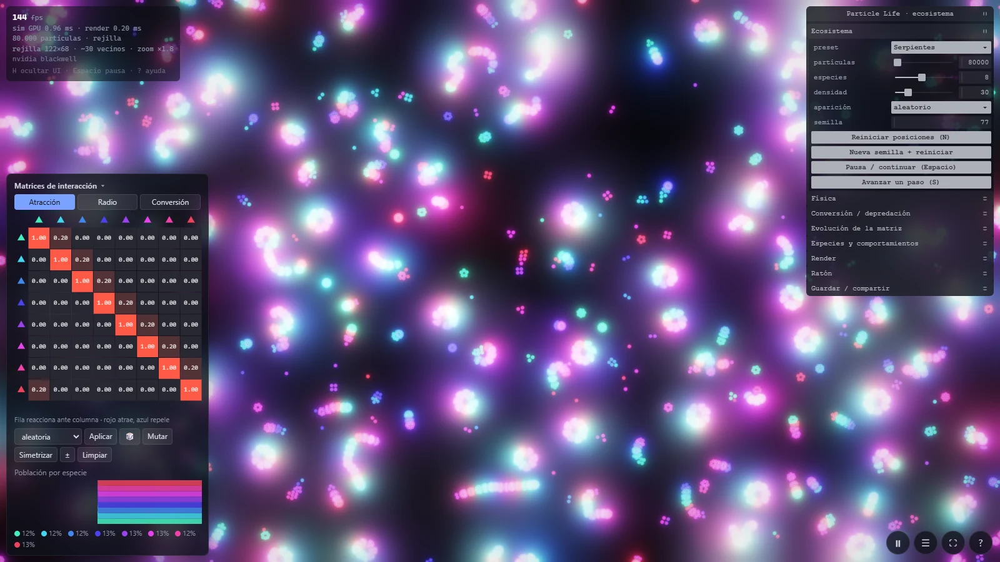
</p>

## Features

| | |
| --- | --- |
| ⚡ **O(N) GPU simulation** | Uniform grid + counting sort in WGSL compute shaders. 1 M particles in ~2 ms per step. |
| 🧬 **Ecosystems, not just physics** | A **conversion** matrix (predation, rock-paper-scissors), per-pair radii and per-species mass, friction, propulsion, noise, spin, alignment and pulse. |
| 🎨 **HDR rendering** | Dual-Kawase bloom, ACES tone mapping, trails, 8 SDF shapes with glow and 5 color modes. |
| 🧩 **Matrix editor** | Drag to tweak, built-in patterns, mutate, symmetrize; live per-species population chart. |
| 💻 **Runs in any browser** | Without WebGPU it falls back to a CPU engine with the same rules (validated against the GPU one). |
| 📱 **Desktop and mobile** | Mouse, keyboard and touch gestures (pinch to zoom); collapsible UI on small screens. |
| 🔗 **Shareable** | Every world can be saved as a compressed link, JSON or PNG screenshot. |
| ✅ **Tested** | 201 unit checks in CI, real-GPU validation (grid vs brute force, CPU vs GPU) and end-to-end tests in Chrome. |

## Presets

| | | |
| :---: | :---: | :---: |
| 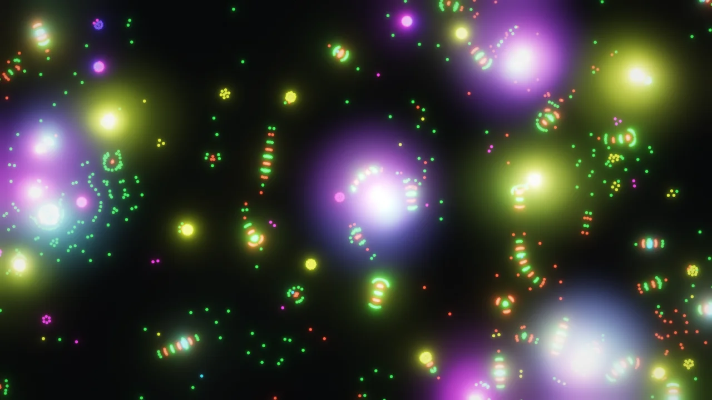<br>**1 · Primordial soup** | 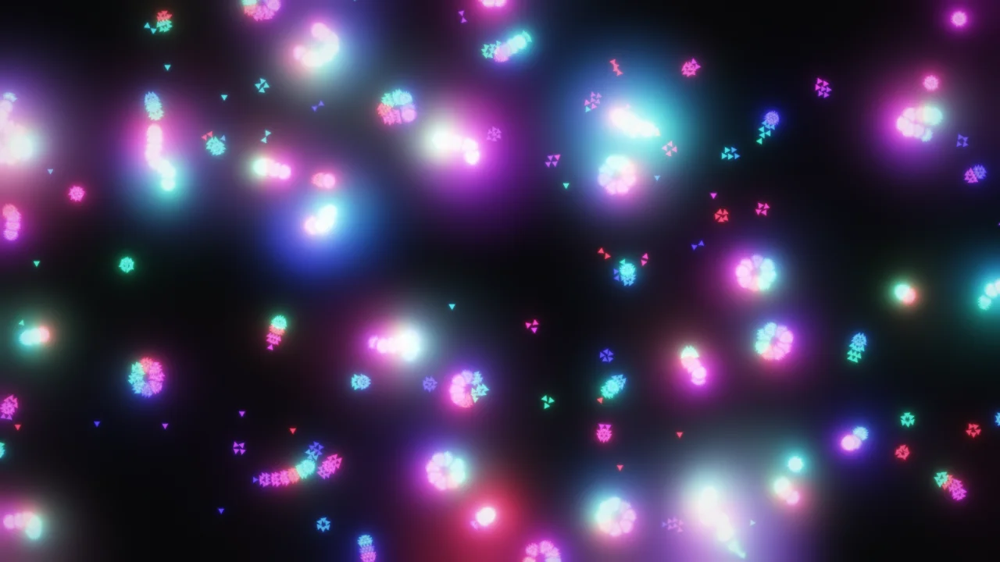<br>**2 · Snakes** | 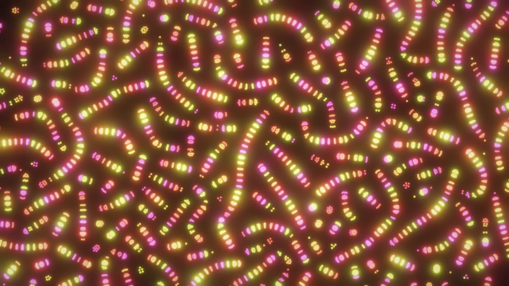<br>**3 · Chains** |
| <br>**4 · Predators and prey** | 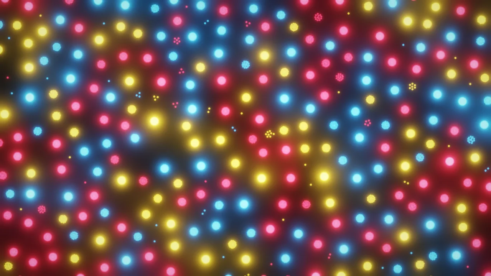<br>**5 · Rock, paper, scissors** | <br>**6 · Cyclic ecosystem (5)** |
| 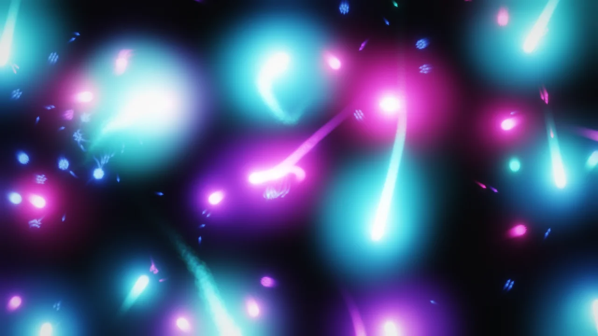<br>**7 · Flocks** | 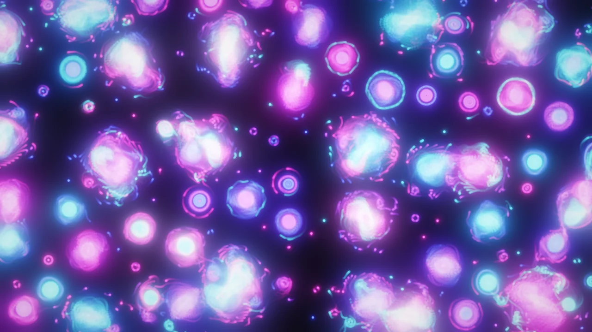<br>**8 · Vortices** | 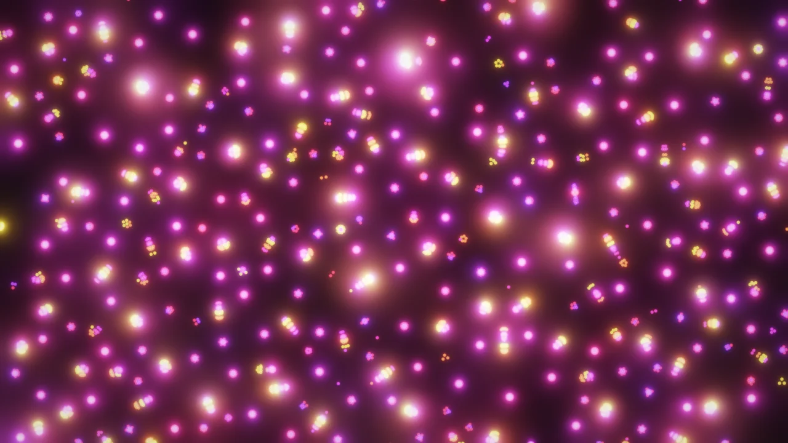<br>**9 · Breathing** |
| 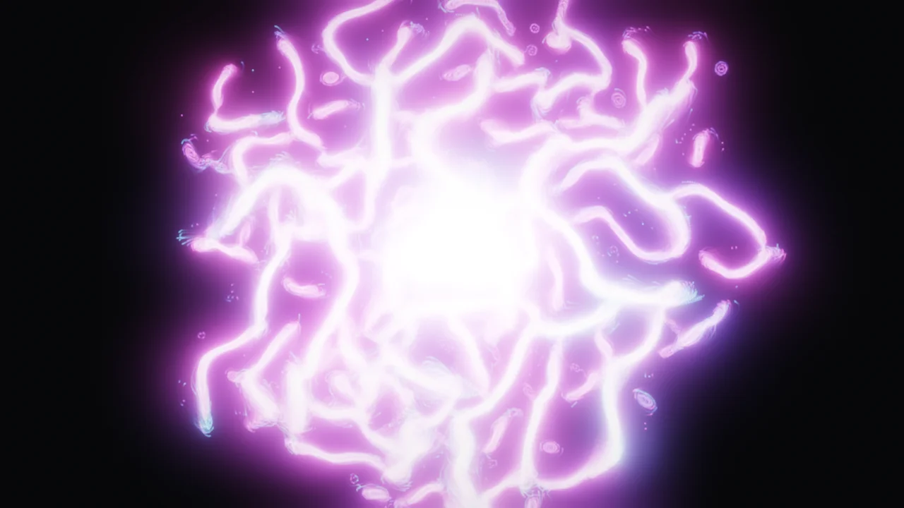<br>**10 · Galaxy** | 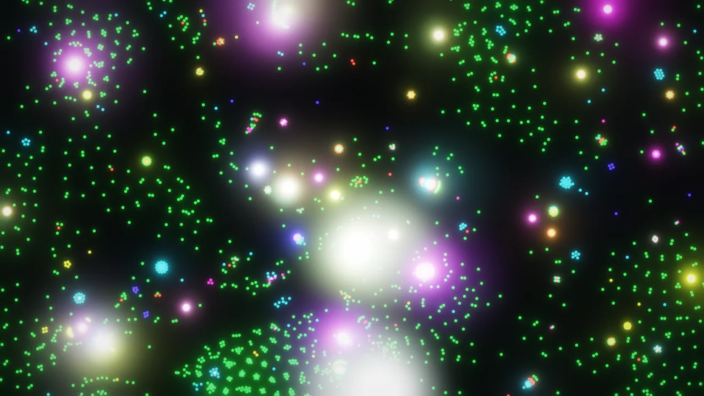<br>**11 · Membranes** | 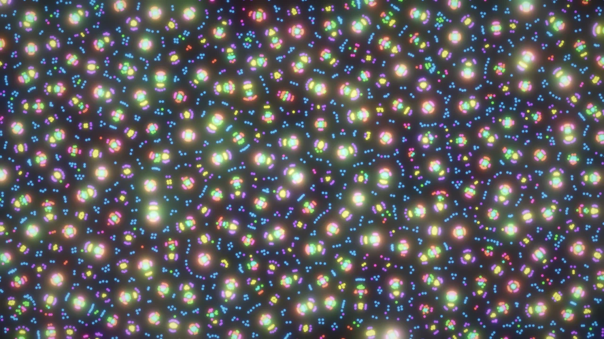<br>**12 · Brownian chaos** |

## Controls

Press <kbd>?</kbd> in the app for the full help.

| Action | Mouse / keyboard | Touch |
| --- | --- | --- |
| Attract / repel particles | click / <kbd>Shift</kbd>+click | 1 finger |
| Pan · zoom | right click · wheel | 2 fingers · pinch |
| Fit world | double click | — |
| Presets | <kbd>1</kbd>–<kbd>9</kbd> | dropdown |
| Pause · single step · reset | <kbd>Space</kbd> · <kbd>S</kbd> · <kbd>N</kbd> | ⏸ button |
| Random matrix · mutate · new seed | <kbd>R</kbd> · <kbd>M</kbd> · <kbd>B</kbd> | editor buttons |
| Trails · PNG screenshot · fullscreen | <kbd>T</kbd> · <kbd>P</kbd> · <kbd>F</kbd> | ⛶ button |
| Hide UI | <kbd>H</kbd> | ☰ button |

## Getting started

Requires **Node.js 20.19+ or 22.12+** (22 recommended) and a WebGPU browser (Chrome / Edge 113+, Safari 26+,
Firefox 141+ on Windows) for the full mode.

```bash
git clone https://github.com/jossseluuu/particleLife.git
cd particleLife
npm install
npm run dev            # http://localhost:5173
```

| Script | What it does |
| --- | --- |
| `npm run dev` | Dev server with hot reload |
| `npm run build` | Type-check and production build into `dist/` |
| `npm run build:single` | Everything in one HTML file (`dist-single/index.html`) that opens without a server |
| `npm test` | 201 GPU-free unit checks (run in CI) |
| `npm run test:gpu` | Validation on your real GPU via Dawn |
| `npm run test:browser` | End-to-end in real Chrome (needs `npm run dev` running) |
| `npm run screenshots` | Regenerates the images in this README |

Append `?cpu` to the URL to force the CPU engine.

## How it works

For each pair with normalized distance `r = d / (rMax · radius_ab)`:
`r < β` → universal repulsion `r/β − 1`; `β ≤ r < 1` → `a_ab · (1 − |2r − 1 − β| / (1 − β))`.

Each GPU step is a single compute pass: **count per cell → two-level prefix sum → physical reorder of
particles by cell → forces from the 3×3 neighbouring cells**, so the cost grows linearly with N.
Semi-implicit integration with exponential friction on a toroidal world. The renderer reads the
simulation buffer directly as instance data — particles never touch the CPU.

The [documentation site](https://jossseluuu.github.io/particleLife/docs/) (Spanish) covers the [physical model](https://jossseluuu.github.io/particleLife/docs/conceptos/modelo-fisico), every [parameter](https://jossseluuu.github.io/particleLife/docs/referencia/parametros) and the [GPU architecture](https://jossseluuu.github.io/particleLife/docs/referencia/arquitectura).

## Contributing

Contributions are welcome — see [CONTRIBUTING.md](CONTRIBUTING.md). Issues and pull requests may be written in English or Spanish.

Inspired by Jeffrey Ventrella's *Clusters*, Tom Mohr's *Particle Life* and the artificial-life community.

## License

[MIT](LICENSE) © 2026 Jose Luis
