<div align="center">

# Particle Life

**Ecosistema 2D de partículas simulado y renderizado íntegramente en GPU con WebGPU.**
Reglas mínimas de atracción y repulsión entre especies → células, serpientes, bandadas, vórtices y ondas espirales.

[](https://github.com/jossseluuu/particleLife/actions/workflows/deploy.yml)
[](https://jossseluuu.github.io/particleLife/)
[](https://www.w3.org/TR/webgpu/)
[](tsconfig.json)
[](https://jossseluuu.github.io/particleLife/docs/)
[](LICENSE)

**[▶ Abrir la demo](https://jossseluuu.github.io/particleLife/)** · **[📚 Documentación](https://jossseluuu.github.io/particleLife/docs/)** · [English](README.en.md) · [Contribuir](CONTRIBUTING.md)

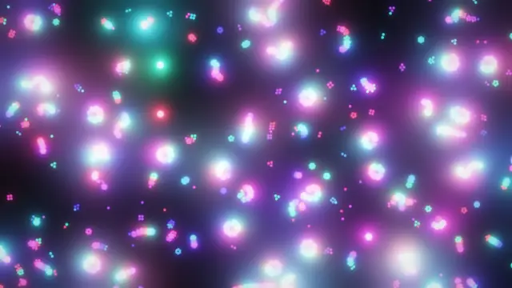

</div>

---

## Índice

- [Qué es](#qué-es)
- [Características](#características)
- [Galería de presets](#galería-de-presets)
- [Controles](#controles)
- [Empezar](#empezar)
- [Rendimiento](#rendimiento)
- [Pruebas](#pruebas)
- [Cómo funciona](#cómo-funciona)
- [Documentación](#documentación)
- [Publicar tu propia copia](#publicar-tu-propia-copia)
- [Contribuir](#contribuir) · [Licencia](#licencia)

## Qué es

Cada color es una **especie**. Cada especie se siente atraída o repelida por las demás según una
**matriz de interacción** — y esa matriz es *asimétrica*: que A persiga a B no implica que B persiga a A.
Al romper la tercera ley de Newton aparecen estructuras que se mueven, se dividen y se cazan entre sí,
como si estuvieran vivas.

Este proyecto lleva la idea al límite en el navegador: hasta **un millón de partículas** a tiempo real,
todo editable mientras corre.

<p align="center">
  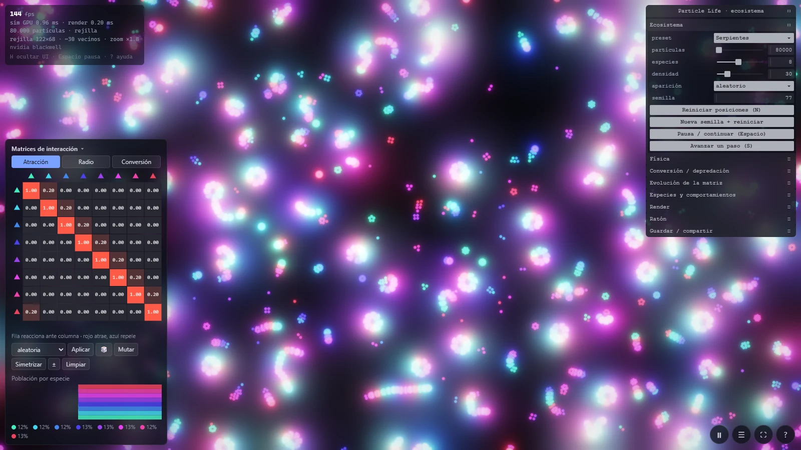
</p>

## Características

| | |
| --- | --- |
| ⚡ **Simulación O(N) en GPU** | Rejilla uniforme + *counting sort* en compute shaders WGSL. 1 M de partículas en ~2 ms por paso. |
| 🧬 **Ecosistemas, no sólo física** | Matriz de **conversión** (depredación, piedra-papel-tijera), radios por pareja, y por especie: masa, rozamiento, propulsión, ruido, giro, alineamiento y pulso. |
| 🎨 **Render HDR** | Bloom *dual-Kawase*, tone mapping ACES, estelas, 8 formas SDF con halo y 5 modos de color. |
| 🧩 **Editor de matrices** | Arrastrar para ajustar, patrones predefinidos, mutar, simetrizar; gráfica de población por especie en vivo. |
| 💻 **Funciona en cualquier navegador** | Sin WebGPU cambia solo a un motor CPU con las mismas reglas (validado contra el de GPU). |
| 📱 **Escritorio y móvil** | Ratón, teclado y gestos táctiles (pellizcar para zoom); interfaz plegable en pantallas pequeñas. |
| 🔗 **Compartible** | Cada mundo se guarda como enlace comprimido, JSON o captura PNG. |
| ✅ **Probado** | 201 comprobaciones unitarias en CI, validación en GPU real (rejilla vs fuerza bruta, CPU vs GPU) y pruebas E2E en Chrome. |

## Galería de presets

Doce mundos listos para explorar (teclas <kbd>1</kbd>–<kbd>9</kbd> o el desplegable *preset*):

| | | |
| :---: | :---: | :---: |
| 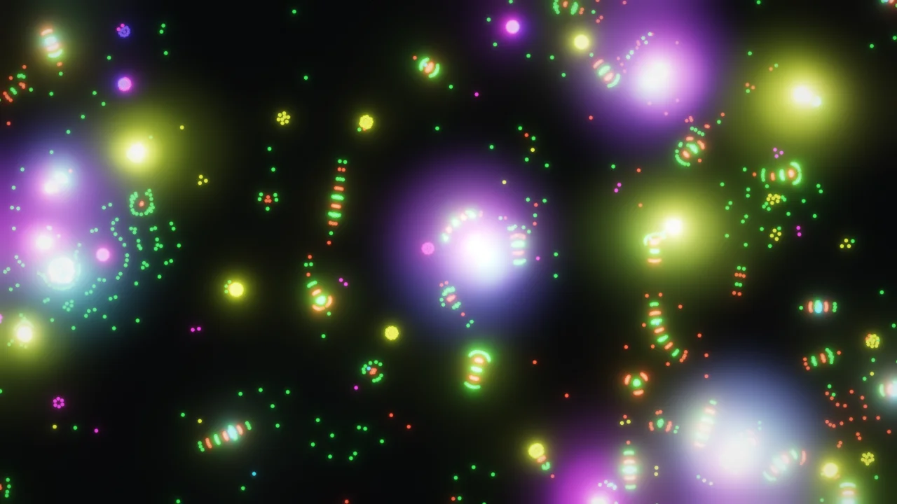<br>**1 · Sopa primordial**<br><sub>matriz aleatoria de 6 especies</sub> | 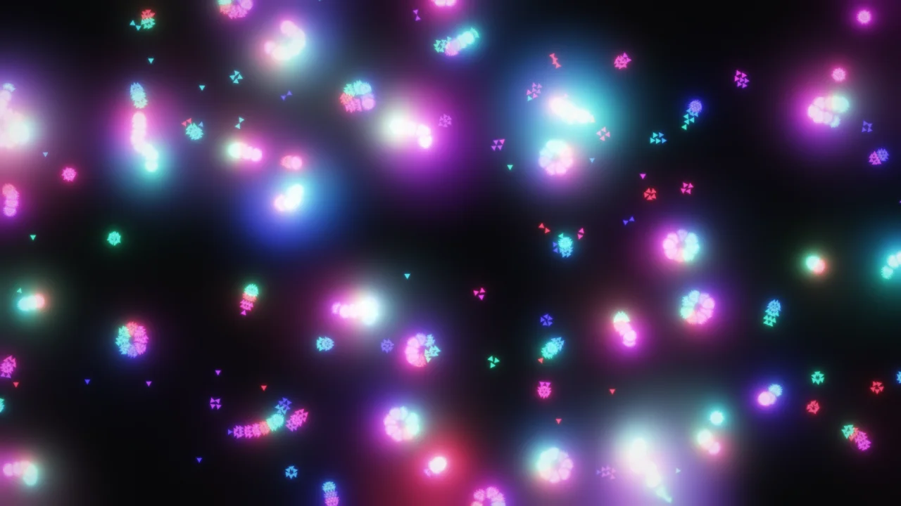<br>**2 · Serpientes**<br><sub>cada especie persigue a la siguiente</sub> | 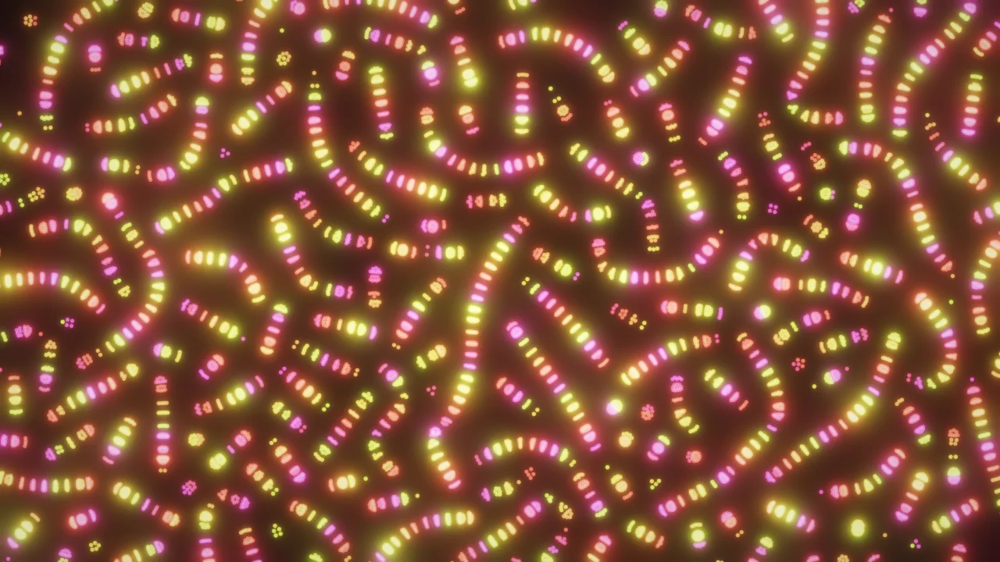<br>**3 · Cadenas**<br><sub>polímeros que se pliegan</sub> |
| <br>**4 · Depredadores y presas**<br><sub>persecución con estelas</sub> | 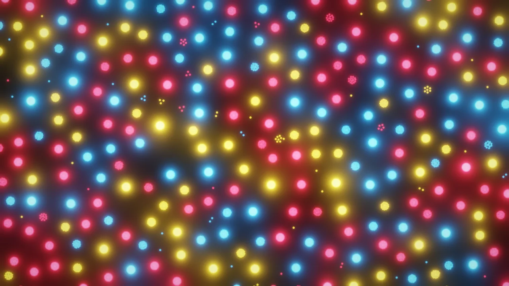<br>**5 · Piedra, papel, tijera**<br><sub>conversión cíclica → ondas espirales</sub> | <br>**6 · Ecosistema cíclico (5)**<br><sub>cinco especies que se convierten</sub> |
| 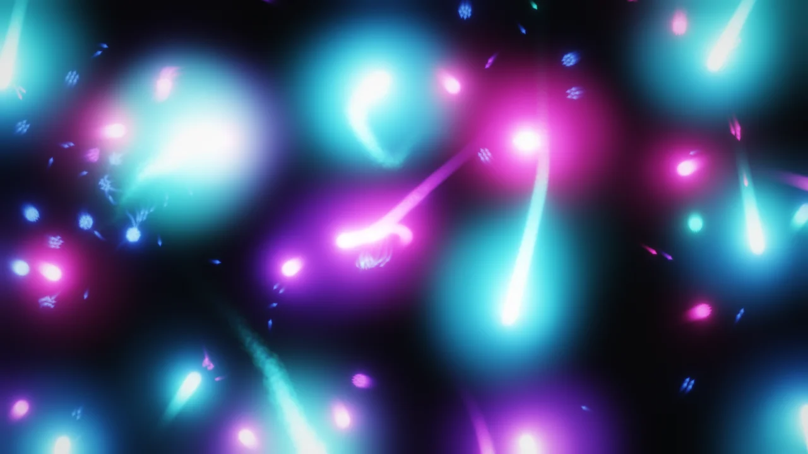<br>**7 · Bandadas**<br><sub>propulsión + alineamiento</sub> | 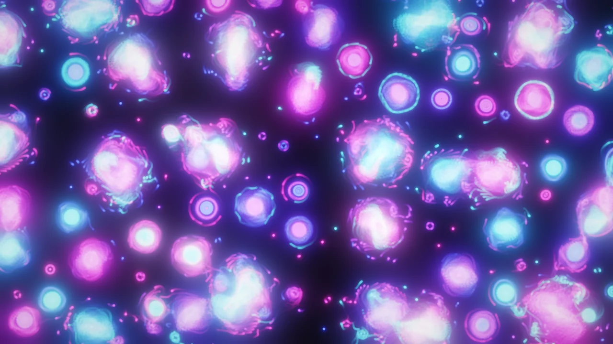<br>**8 · Vórtices**<br><sub>especies que giran en sentidos opuestos</sub> | 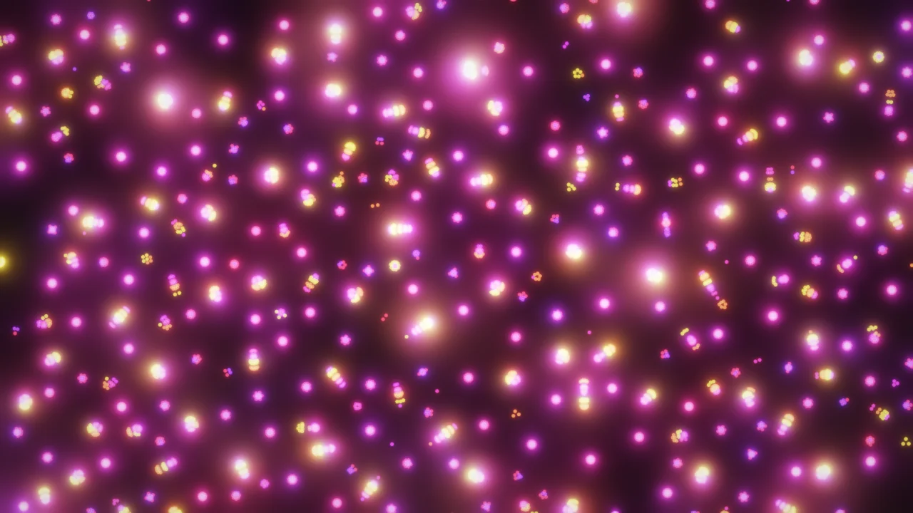<br>**9 · Respiración**<br><sub>células con pulso propio</sub> |
| 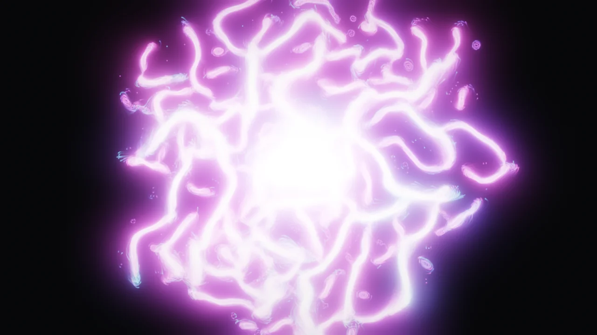<br>**10 · Galaxia**<br><sub>big bang con rotación</sub> | 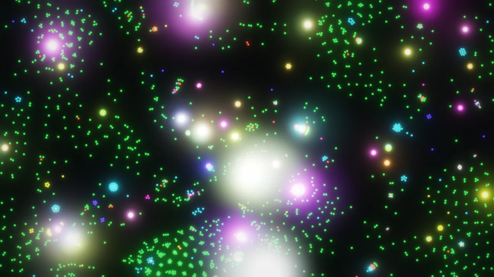<br>**11 · Membranas**<br><sub>radios distintos por pareja</sub> | 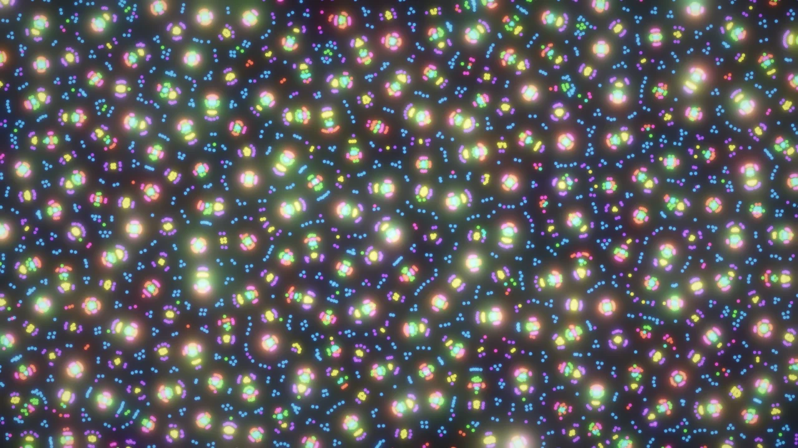<br>**12 · Caos browniano**<br><sub>ruido por especie</sub> |

<details>
<summary><b>Editor de matrices, modo CPU y móvil</b></summary>
<br>

| Editor de matrices | Modo CPU (sin WebGPU) | Móvil |
| :---: | :---: | :---: |
| 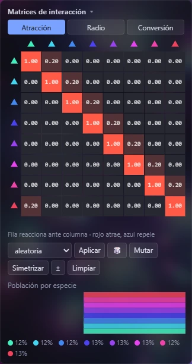 | 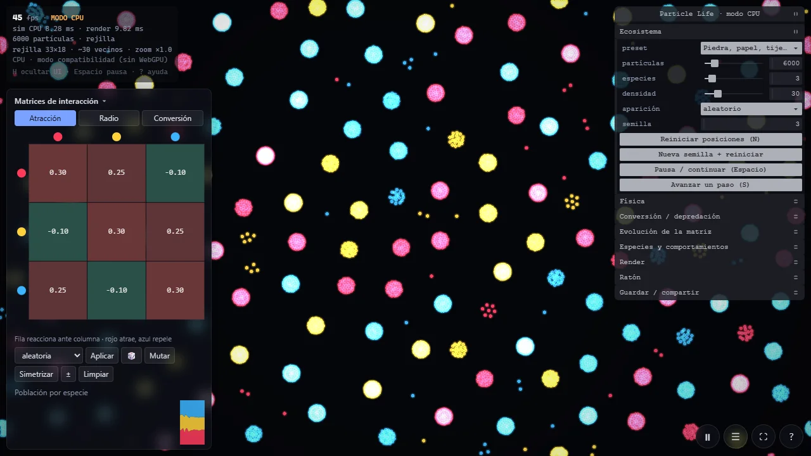 | 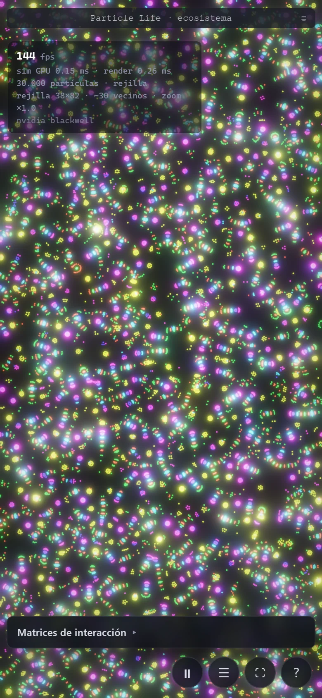 |

</details>

## Controles

Pulsa <kbd>?</kbd> dentro de la app para ver la ayuda completa.

| Acción | Ratón / teclado | Táctil |
| --- | --- | --- |
| Atraer / repeler partículas | clic / <kbd>Shift</kbd>+clic | 1 dedo |
| Desplazar · zoom | clic derecho · rueda | 2 dedos · pellizcar |
| Encuadrar el mundo | doble clic | — |
| Presets | <kbd>1</kbd>–<kbd>9</kbd> | desplegable |
| Pausa · paso a paso · reiniciar | <kbd>Espacio</kbd> · <kbd>S</kbd> · <kbd>N</kbd> | botón ⏸ |
| Matriz aleatoria · mutar · nueva semilla | <kbd>R</kbd> · <kbd>M</kbd> · <kbd>B</kbd> | botones del editor |
| Estelas · captura PNG · pantalla completa | <kbd>T</kbd> · <kbd>P</kbd> · <kbd>F</kbd> | botón ⛶ |
| Ocultar interfaz | <kbd>H</kbd> | botón ☰ |

**En el editor de matrices:** arrastrar ↕ ajusta · rueda = paso fino · clic derecho = neutro ·
doble clic = aleatorio · <kbd>Shift</kbd> edita (a,b) y (b,a) a la vez.

## Empezar

Requisitos: **Node.js 20.19+ o 22.12+** (recomendado 22, ver [`.nvmrc`](.nvmrc)) y un navegador con WebGPU
(Chrome / Edge 113+, Safari 26+, Firefox 141+ en Windows) para el modo completo.

```bash
git clone https://github.com/jossseluuu/particleLife.git
cd particleLife
npm install
npm run dev            # http://localhost:5173
```

| Script | Qué hace |
| --- | --- |
| `npm run dev` | Servidor de desarrollo con recarga en caliente |
| `npm run build` | Comprueba tipos y genera la versión de producción en `dist/` |
| `npm run build:single` | Todo en un único HTML (`dist-single/index.html`) que se abre sin servidor |
| `npm run preview` | Sirve `dist/` para probar la build |
| `npm run screenshots` | Regenera las imágenes de este README (`docs/media/`) con Chrome real |

Añade `?cpu` a la URL para forzar el modo CPU.

> **¿Ves «MODO CPU» en Chrome o Edge?** Activa la aceleración por hardware
> (Configuración → Sistema → «Usar aceleración gráfica cuando esté disponible») y reinicia el navegador.
> En portátiles con dos GPU, asigna el navegador a la dedicada en
> Windows → Configuración → Pantalla → Gráficos → Alto rendimiento.

## Rendimiento

Tiempo de un paso de simulación (compute) medido con `npm run test:gpu`:

| Partículas | NVIDIA RTX 5050 Laptop | AMD Radeon 780M (integrada) |
| ---: | ---: | ---: |
| 50 000 | 0,24 ms | — |
| 200 000 | 0,45 ms | — |
| 500 000 | 1,06 ms | — |
| 1 000 000 | 2,15 ms | ~9 ms |

El coste crece de forma lineal con el número de partículas: cada una sólo mira las 3×3 celdas vecinas
(~30 vecinos de media con la densidad por defecto) en lugar de las N−1 restantes.
El modo CPU arranca con 6 000 partículas para mantener una tasa de frames fluida.

## Pruebas

```bash
npm test               # 201 comprobaciones unitarias sin GPU (se ejecutan en CI)
npm run test:gpu       # en tu GPU con Dawn: rejilla vs fuerza bruta, CPU vs GPU, estabilidad, rendimiento
npm run test:browser   # con `npm run dev` arrancado: Chrome real en escritorio GPU, modo CPU y móvil táctil
npm run test:all       # tipos + unitarios + GPU
```

Qué se valida:

- **Corrección del algoritmo O(N)** — la rejilla da el mismo resultado que la fuerza bruta O(N²), en GPU y en CPU.
- **Equivalencia de motores** — un paso en CPU y en GPU desde el mismo estado coincide (error ~1e-4, float32 frente a float64).
- **Física** — dos partículas que se atraen se estabilizan exactamente a β·rMax; interacción a través del borde toroidal; conservación del centro de masas.
- **Estabilidad** de los 12 presets — sin NaN, población conservada, velocidad acotada.
- **Configuración** — redimensionado de matrices, normalización y enlace comprimido de ida y vuelta.
- **Navegador** — presets (teclado y desplegable), editor, zoom, pausa, ayuda, enlace compartible, modo CPU y gestos táctiles, sin errores en consola.

## Cómo funciona

Fuerza entre dos partículas en función de la distancia normalizada `r = d / (rMax · radio_ab)`:

```text
        fuerza
          ▲          a_ab > 0 → atracción
     a_ab ┤        ╱╲
          │      ╱    ╲
        0 ┼────╱────────╲──────▶ r
          │  ╱β          1
       −1 ┤╱   repulsión universal (evita que colapsen)
```

- `r < β` → repulsión `r/β − 1`
- `β ≤ r < 1` → `a_ab · (1 − |2r − 1 − β| / (1 − β))`

Cada paso en GPU es un único compute pass con cuatro fases: **conteo por celda → prefix-sum en dos
niveles → reordenación física de las partículas → fuerzas sobre las 3×3 celdas vecinas**.
Integración semi-implícita con rozamiento exponencial en un mundo toroidal.

Explicación completa en la documentación: [modelo físico](https://jossseluuu.github.io/particleLife/docs/conceptos/modelo-fisico), [comportamientos](https://jossseluuu.github.io/particleLife/docs/conceptos/comportamientos) y [arquitectura en GPU](https://jossseluuu.github.io/particleLife/docs/referencia/arquitectura).

## Documentación

La **[web de documentación](https://jossseluuu.github.io/particleLife/docs/)** (con buscador) cubre todo lo que este README resume:

| Sección | Contenido |
| --- | --- |
| [Guía](https://jossseluuu.github.io/particleLife/docs/guia/empezar) | Primeros pasos, interfaz, controles, editor de matrices, guardar y compartir, problemas frecuentes |
| [Recetas](https://jossseluuu.github.io/particleLife/docs/guia/recetas) | Paso a paso para conseguir células, serpientes, bandadas, vórtices, ondas espirales o galaxias |
| [Galería de presets](https://jossseluuu.github.io/particleLife/docs/guia/presets) | Los 12 presets con sus matrices reales y enlace para abrir cada uno |
| [Conceptos](https://jossseluuu.github.io/particleLife/docs/conceptos/particle-life) | Emergencia y asimetría, la ley de fuerza, la integración y cada comportamiento |
| [Referencia](https://jossseluuu.github.io/particleLife/docs/referencia/parametros) | Los 53 parámetros, el formato de guardado con [JSON Schema](https://jossseluuu.github.io/particleLife/docs/config.schema.json), arquitectura y rendimiento |
| [Desarrollo](https://jossseluuu.github.io/particleLife/docs/desarrollo/contribuir) | Contribuir, pruebas y cómo funciona el sistema de documentación |

La referencia de parámetros, la galería de presets y el JSON Schema **se generan del código**
(`npm run docs:gen`) y el CI falla si se quedan desfasados. Para trabajar en ella: `npm run docs:dev`.

## Publicar tu propia copia

El workflow [`deploy.yml`](.github/workflows/deploy.yml) comprueba tipos, ejecuta los tests, compila y
publica en GitHub Pages en cada push a `main`.

1. Haz un fork (o sube tu copia a un repositorio nuevo).
2. En GitHub: **Settings → Pages → Source: GitHub Actions**.
3. Haz push a `main`: en ~2 minutos estará en `https://<usuario>.github.io/<repositorio>/`
   y la documentación en `…/<repositorio>/docs/`.

Si tu repositorio no se llama `particleLife`, cambia `base` en `docs/.vitepress/config.mts`
(la app no lo necesita: usa rutas relativas).

`vite.config.ts` usa `base: './'`, así que `dist/` funciona en cualquier subruta o hosting estático
(Netlify, Vercel, Cloudflare Pages, un servidor propio…).

## Contribuir

¡Las contribuciones son bienvenidas! Lee [CONTRIBUTING.md](CONTRIBUTING.md) para preparar el entorno,
ejecutar las pruebas y proponer cambios. Ideas sencillas para empezar: nuevos presets, nuevos patrones
de matriz o nuevas formas SDF. Este proyecto sigue un [código de conducta](CODE_OF_CONDUCT.md).

Inspirado en el trabajo de Jeffrey Ventrella (*Clusters*), Tom Mohr (*Particle Life*) y la comunidad de vida artificial.

## Licencia

[MIT](LICENSE) © 2026 Jose Luis
