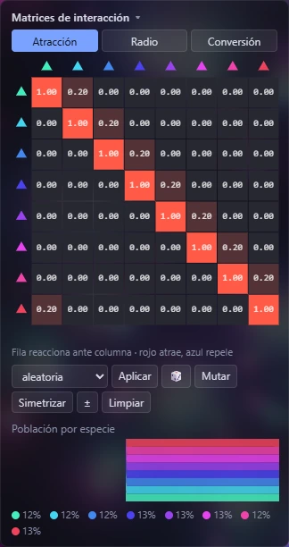

# Editor de matrices

<figure>
  
  <figcaption>Pestaña «Atracción» del preset «Serpientes».</figcaption>
</figure>

Las matrices son **las reglas del mundo**. Con S especies, cada matriz tiene S×S celdas.

**Cómo leerla:** la celda de la fila *a* y la columna *b* dice cómo **reacciona la especie a ante la
especie b**. Los triángulos de colores de la cabecera indican qué especie es cada fila y columna.

La matriz **no tiene por qué ser simétrica**: que el rojo persiga al azul no obliga al azul a perseguir
al rojo. De ahí salen las persecuciones y las estructuras que se desplazan
(ver [¿Qué es Particle Life?](../conceptos/particle-life#la-clave-la-asimetria)).

## Las tres pestañas

| Pestaña | Rango | Neutro | Qué controla |
| --- | --- | --- | --- |
| **Atracción** | −1 … 1 | 0 | Positivo: a se acerca a b. Negativo: a se aleja de b. |
| **Radio** | 0,1 … 1 | 1 | Alcance de la interacción de cada pareja, como fracción de `rMax`. Con radios distintos aparecen capas y membranas. |
| **Conversión** | 0 … 5 | 0 | Con qué fuerza **a convierte a b** en su especie al tocarla. Sólo tiene efecto si activas *Conversión / depredación → activa* en el panel. |

La diagonal (a ante a) define cómo se comporta cada especie consigo misma: valores positivos forman
grupos compactos; negativos, especies que se dispersan.

## Editar celdas

| Gesto | Efecto |
| --- | --- |
| Arrastrar ↕ | Ajustar el valor |
| Rueda | Paso fino |
| Clic derecho | Valor neutro |
| Doble clic | Valor aleatorio |
| <kbd>Shift</kbd> + gesto | Editar (a,b) y (b,a) a la vez |

## Botones

| Botón | Efecto sobre la matriz de la pestaña activa |
| --- | --- |
| Desplegable + **Aplicar** | Aplica un [patrón](./presets#patrones-de-matriz): aleatoria, simétrica, serpientes, cadenas, persecución, células, solo diagonal, cero |
| **🎲** | Valores aleatorios (tecla <kbd>R</kbd>). En *Conversión* sólo rellena algunas celdas, para que no todo convierta a todo |
| **Mutar** | Pequeña variación aleatoria (tecla <kbd>M</kbd>). Ideal para explorar alrededor de un mundo que te gusta |
| **Simetrizar** | Promedia (a,b) y (b,a). Las matrices simétricas tienden a estados quietos, tipo cristal |
| **±** | Invierte: en *Atracción* cambia el signo; en las otras refleja el valor dentro de su rango |
| **Limpiar** | Pone todas las celdas al valor neutro |

## Gráfica de población

Debajo de los botones se dibuja el porcentaje de partículas de cada especie a lo largo del tiempo.
Sin conversión la población no cambia; con conversión verás ciclos, extinciones o equilibrios.

## Evolución automática

En el panel, *Evolución de la matriz → deriva continua* hace que la matriz de atracción cambie sola con
un paseo aleatorio suave (`drift.rate` controla la velocidad). El mundo nunca se estanca: estructuras que
nacen, se transforman y desaparecen.

## Ideas rápidas

- **Diagonal positiva y resto cero** → cada especie forma sus propias gotas.
- **a atrae a b y b repele a a** → a persigue a b sin alcanzarla.
- **Cadena cíclica** (a→b→c→a con atracción) → serpientes y anillos que giran.
- Más recetas paso a paso en [Recetas](./recetas).
