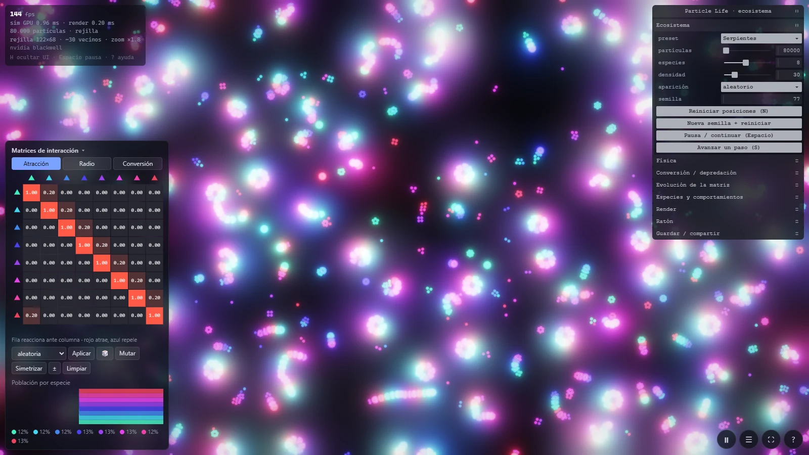
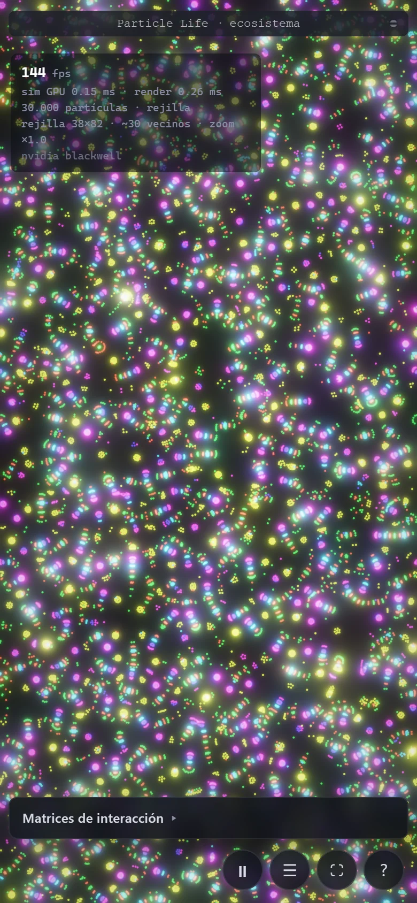

# La interfaz

<figure>
  
  <figcaption>Arriba a la izquierda el HUD, abajo a la izquierda el editor de matrices, a la derecha el panel y abajo a la derecha los botones flotantes.</figcaption>
</figure>

Pulsa <kbd>H</kbd> (o el botón ☰) para ocultar toda la interfaz y ver sólo la simulación.

## HUD (arriba a la izquierda)

| Línea | Significado |
| --- | --- |
| `144 fps` | Frames por segundo. Si aparece **MODO CPU**, la simulación corre en el procesador. |
| `sim GPU 0.41 ms · render 0.21 ms` | Tiempo de cada paso de simulación y de dibujo, medido en la propia GPU cuando el navegador lo permite. |
| `80.000 partículas · rejilla` | Población y algoritmo (`rejilla` O(N) o `fuerza bruta` O(N²)). |
| `rejilla 122×68 · ~30 vecinos · zoom ×1.0` | Celdas de la rejilla espacial, vecinos medios por partícula y zoom de la cámara. |
| `nvidia blackwell` | La GPU que está usando el navegador. |

## Editor de matrices (abajo a la izquierda)

Las reglas del mundo. Tiene tres pestañas (**Atracción**, **Radio** y **Conversión**), una fila de
botones y la **gráfica de población** por especie. Haz clic en el título para plegarlo.
Se explica a fondo en [Editor de matrices](./editor-matrices).

## Panel (derecha)

Todos los parámetros, agrupados en carpetas. Cada uno está descrito en la
[referencia de parámetros](../referencia/parametros).

| Carpeta | Para qué |
| --- | --- |
| **Ecosistema** | Preset, nº de partículas y especies, densidad, modo de aparición, semilla; reiniciar, pausa y paso a paso |
| **Física** | Radio máximo, β, repulsión, fuerza, rozamiento, `dt`, velocidad máxima, pasos por frame y algoritmo |
| **Conversión / depredación** | Activar la conversión de especies y su radio de contacto |
| **Evolución de la matriz** | Deriva continua: la matriz cambia sola poco a poco |
| **Especies y comportamientos** | Color, forma, tamaño, masa, propulsión, ruido, giro, alineamiento y pulso de cada especie |
| **Render** | Modo de color, tamaño, halo, estelas, bloom, exposición, tone mapping, viñeta y fondo |
| **Ratón** | Radio y fuerza del pincel |
| **Guardar / compartir** | Enlace, JSON, guardados en el navegador. Ver [Guardar y compartir](./compartir) |

::: info Parámetros que reinician
Cambiar el número de partículas, de especies, la densidad, el modo de aparición o la semilla vuelve a
colocar las partículas. El resto se aplica en caliente, sin perder el estado.
:::

## Botones flotantes (abajo a la derecha)

| Botón | Acción | Tecla |
| --- | --- | --- |
| ⏸ / ▶ | Pausa / continuar | <kbd>Espacio</kbd> |
| ☰ | Mostrar / ocultar la interfaz | <kbd>H</kbd> |
| ⛶ | Pantalla completa | <kbd>F</kbd> |
| ? | Ayuda rápida | <kbd>?</kbd> |

## En el móvil

<figure>
  
  <figcaption>En pantallas pequeñas el panel y el editor empiezan plegados.</figcaption>
</figure>

- Arranca con **30 000 partículas** para ir fluido.
- **Un dedo** atrae partículas; **dos dedos** desplazan y **pellizcar** hace zoom.
- Toca los títulos del panel y del editor de matrices para desplegarlos.
- ☰ oculta todo para ver la simulación a pantalla completa.

