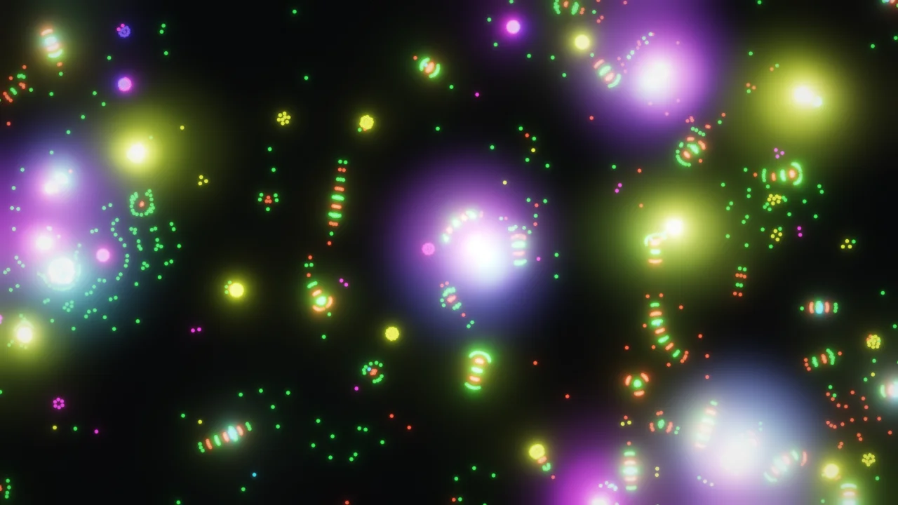
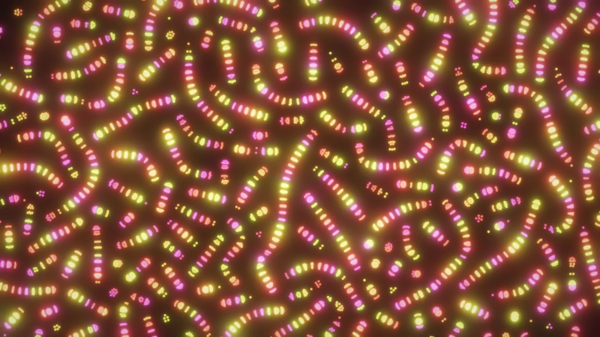
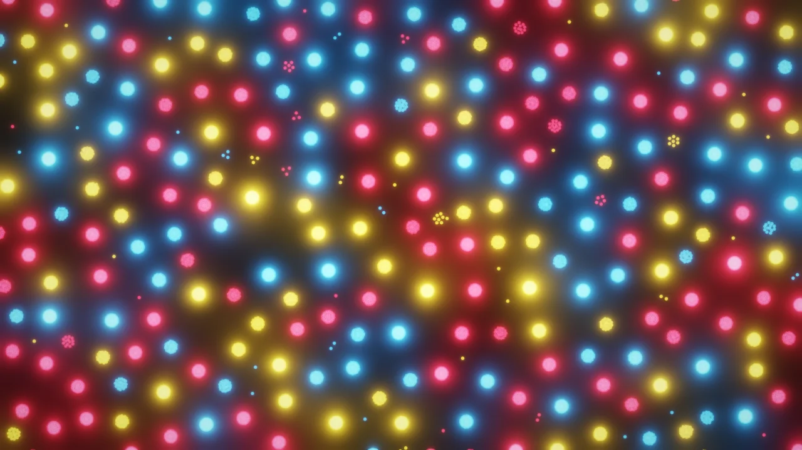
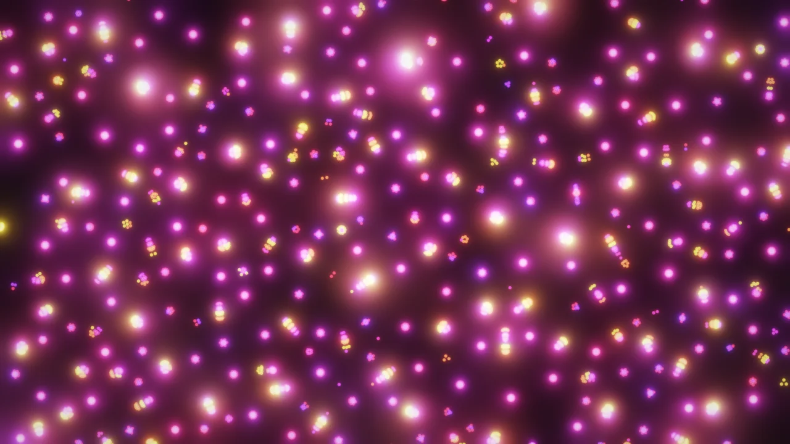
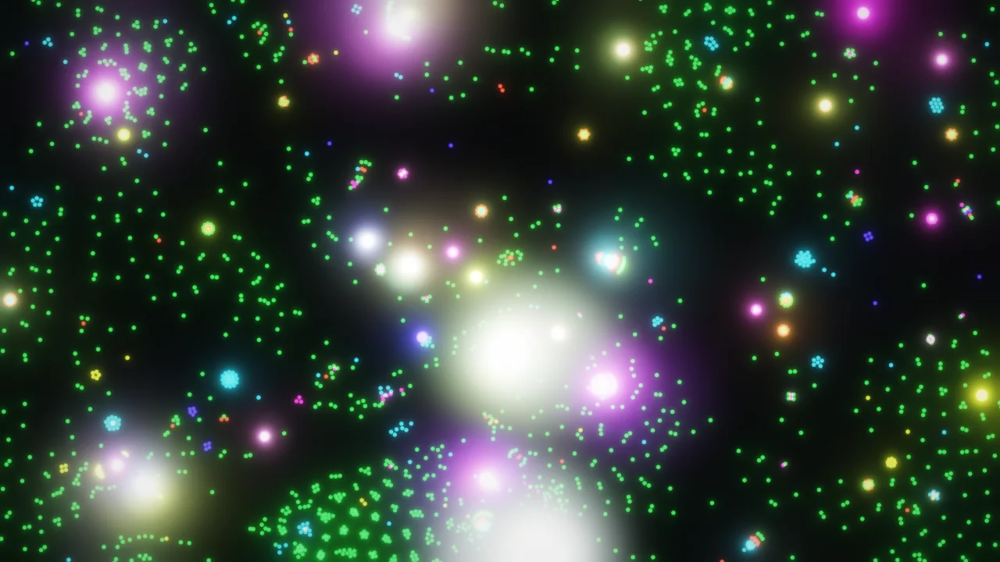
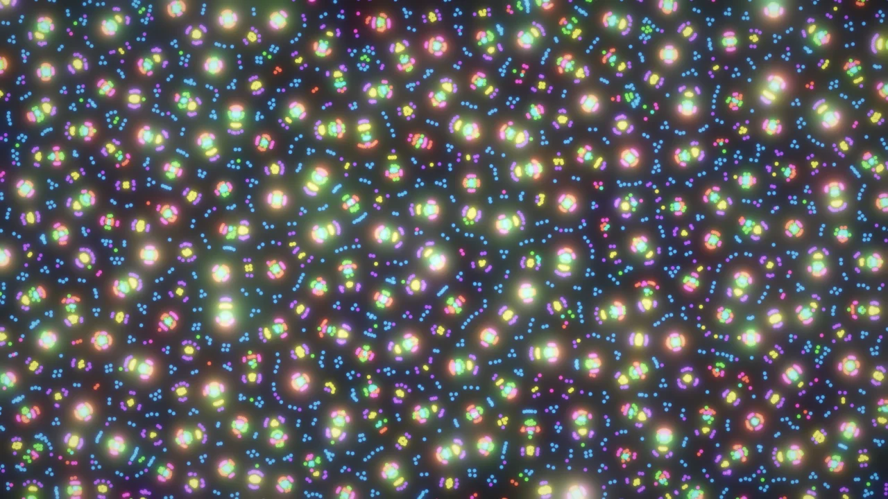

<!-- ARCHIVO GENERADO por scripts/gen-docs.ts a partir de src/presets.ts. No lo edites a mano: ejecuta `npm run docs:gen`. -->

# Galería de presets

Doce mundos listos para explorar. Se cargan con las teclas <kbd>1</kbd>–<kbd>9</kbd>, con el desplegable
*preset* del panel o con un enlace `#preset=N` como los de esta página.

Cada preset parte de la [configuración por defecto](../referencia/parametros) y cambia sólo lo que se
indica. En las matrices, la **fila** es la especie que reacciona y la **columna** aquélla ante la que
reacciona: rojo atrae, azul repele.

::: tip Experimenta
Carga un preset y pulsa <kbd>M</kbd> para mutar ligeramente su matriz, o <kbd>B</kbd> para cambiar la
semilla: verás variaciones del mismo comportamiento.
:::

## 1 · Sopa primordial

Seis especies con una matriz aleatoria: el punto de partida clásico, donde cada semilla da un mundo distinto.

<a class="demo-link" href="https://jossseluuu.github.io/particleLife/#preset=1" target="_blank" rel="noopener">▶ Abrir en la demo</a> · tecla <kbd>1</kbd>

| Especies | Aparición | Semilla | Conversión |
| --- | --- | --- | --- |
| 6 | `aleatorio` | 1234 | no |

Matriz de atracción

<table class="matrix"><thead><tr><th></th><th></th><th></th><th></th><th></th><th></th><th></th></tr></thead><tbody><tr><th></th><td style="background:rgba(59, 130, 246, 0.73)">-0.85</td><td style="background:rgba(244, 63, 94, 0.35)">0.41</td><td style="background:rgba(244, 63, 94, 0.68)">0.81</td><td style="background:rgba(244, 63, 94, 0.80)">0.94</td><td style="background:rgba(59, 130, 246, 0.78)">-0.92</td><td style="background:rgba(59, 130, 246, 0.65)">-0.76</td></tr><tr><th></th><td style="background:rgba(59, 130, 246, 0.57)">-0.68</td><td style="background:rgba(244, 63, 94, 0.51)">0.61</td><td style="background:rgba(59, 130, 246, 0.17)">-0.20</td><td style="background:rgba(59, 130, 246, 0.63)">-0.75</td><td style="background:rgba(244, 63, 94, 0.08)">0.09</td><td style="background:rgba(59, 130, 246, 0.31)">-0.36</td></tr><tr><th></th><td style="background:rgba(244, 63, 94, 0.84)">0.99</td><td style="background:rgba(244, 63, 94, 0.07)">0.09</td><td style="background:rgba(59, 130, 246, 0.40)">-0.47</td><td style="background:rgba(59, 130, 246, 0.14)">-0.17</td><td style="background:rgba(59, 130, 246, 0.01)">-0.01</td><td style="background:rgba(59, 130, 246, 0.69)">-0.82</td></tr><tr><th></th><td style="background:rgba(244, 63, 94, 0.78)">0.91</td><td style="background:rgba(244, 63, 94, 0.63)">0.74</td><td style="background:rgba(244, 63, 94, 0.00)">0.00</td><td style="background:rgba(244, 63, 94, 0.83)">0.97</td><td style="background:rgba(244, 63, 94, 0.70)">0.83</td><td style="background:rgba(59, 130, 246, 0.45)">-0.52</td></tr><tr><th></th><td style="background:rgba(244, 63, 94, 0.23)">0.28</td><td style="background:rgba(59, 130, 246, 0.52)">-0.61</td><td style="background:rgba(244, 63, 94, 0.10)">0.12</td><td style="background:rgba(244, 63, 94, 0.17)">0.20</td><td style="background:rgba(244, 63, 94, 0.66)">0.77</td><td style="background:rgba(244, 63, 94, 0.81)">0.96</td></tr><tr><th></th><td style="background:rgba(59, 130, 246, 0.30)">-0.35</td><td style="background:rgba(59, 130, 246, 0.55)">-0.65</td><td style="background:rgba(244, 63, 94, 0.05)">0.06</td><td style="background:rgba(59, 130, 246, 0.30)">-0.35</td><td style="background:rgba(244, 63, 94, 0.31)">0.37</td><td style="background:rgba(244, 63, 94, 0.81)">0.95</td></tr></tbody></table>

## 2 · Serpientes

Cada especie se atrae a sí misma y un poco a la siguiente: se forman cadenas que reptan persiguiendo su propia cola.

<a class="demo-link" href="https://jossseluuu.github.io/particleLife/#preset=2" target="_blank" rel="noopener">▶ Abrir en la demo</a> · tecla <kbd>2</kbd>

| Especies | Aparición | Semilla | Conversión |
| --- | --- | --- | --- |
| 8 | `aleatorio` | 77 | no |

**Cambia respecto a lo normal:** `species.shape` = triángulo · `render.pointSize` = 0,2

Matriz de atracción

<table class="matrix"><thead><tr><th></th><th></th><th></th><th></th><th></th><th></th><th></th><th></th><th></th></tr></thead><tbody><tr><th></th><td style="background:rgba(244, 63, 94, 0.85)">1.00</td><td style="background:rgba(244, 63, 94, 0.17)">0.20</td><td style="background:transparent">0.00</td><td style="background:transparent">0.00</td><td style="background:transparent">0.00</td><td style="background:transparent">0.00</td><td style="background:transparent">0.00</td><td style="background:transparent">0.00</td></tr><tr><th></th><td style="background:transparent">0.00</td><td style="background:rgba(244, 63, 94, 0.85)">1.00</td><td style="background:rgba(244, 63, 94, 0.17)">0.20</td><td style="background:transparent">0.00</td><td style="background:transparent">0.00</td><td style="background:transparent">0.00</td><td style="background:transparent">0.00</td><td style="background:transparent">0.00</td></tr><tr><th></th><td style="background:transparent">0.00</td><td style="background:transparent">0.00</td><td style="background:rgba(244, 63, 94, 0.85)">1.00</td><td style="background:rgba(244, 63, 94, 0.17)">0.20</td><td style="background:transparent">0.00</td><td style="background:transparent">0.00</td><td style="background:transparent">0.00</td><td style="background:transparent">0.00</td></tr><tr><th></th><td style="background:transparent">0.00</td><td style="background:transparent">0.00</td><td style="background:transparent">0.00</td><td style="background:rgba(244, 63, 94, 0.85)">1.00</td><td style="background:rgba(244, 63, 94, 0.17)">0.20</td><td style="background:transparent">0.00</td><td style="background:transparent">0.00</td><td style="background:transparent">0.00</td></tr><tr><th></th><td style="background:transparent">0.00</td><td style="background:transparent">0.00</td><td style="background:transparent">0.00</td><td style="background:transparent">0.00</td><td style="background:rgba(244, 63, 94, 0.85)">1.00</td><td style="background:rgba(244, 63, 94, 0.17)">0.20</td><td style="background:transparent">0.00</td><td style="background:transparent">0.00</td></tr><tr><th></th><td style="background:transparent">0.00</td><td style="background:transparent">0.00</td><td style="background:transparent">0.00</td><td style="background:transparent">0.00</td><td style="background:transparent">0.00</td><td style="background:rgba(244, 63, 94, 0.85)">1.00</td><td style="background:rgba(244, 63, 94, 0.17)">0.20</td><td style="background:transparent">0.00</td></tr><tr><th></th><td style="background:transparent">0.00</td><td style="background:transparent">0.00</td><td style="background:transparent">0.00</td><td style="background:transparent">0.00</td><td style="background:transparent">0.00</td><td style="background:transparent">0.00</td><td style="background:rgba(244, 63, 94, 0.85)">1.00</td><td style="background:rgba(244, 63, 94, 0.17)">0.20</td></tr><tr><th></th><td style="background:rgba(244, 63, 94, 0.17)">0.20</td><td style="background:transparent">0.00</td><td style="background:transparent">0.00</td><td style="background:transparent">0.00</td><td style="background:transparent">0.00</td><td style="background:transparent">0.00</td><td style="background:transparent">0.00</td><td style="background:rgba(244, 63, 94, 0.85)">1.00</td></tr></tbody></table>

## 3 · Cadenas

Atracción con los vecinos de la cadena y repulsión con el resto: polímeros que se pliegan sin llegar a mezclarse.

<a class="demo-link" href="https://jossseluuu.github.io/particleLife/#preset=3" target="_blank" rel="noopener">▶ Abrir en la demo</a> · tecla <kbd>3</kbd>

| Especies | Aparición | Semilla | Conversión |
| --- | --- | --- | --- |
| 6 | `aleatorio` | 99 | no |

**Cambia respecto a lo normal:** `beta` = 0,25

Matriz de atracción

<table class="matrix"><thead><tr><th></th><th></th><th></th><th></th><th></th><th></th><th></th></tr></thead><tbody><tr><th></th><td style="background:rgba(244, 63, 94, 0.85)">1.00</td><td style="background:rgba(244, 63, 94, 0.17)">0.20</td><td style="background:rgba(59, 130, 246, 0.85)">-1.00</td><td style="background:rgba(59, 130, 246, 0.85)">-1.00</td><td style="background:rgba(59, 130, 246, 0.85)">-1.00</td><td style="background:rgba(244, 63, 94, 0.17)">0.20</td></tr><tr><th></th><td style="background:rgba(244, 63, 94, 0.17)">0.20</td><td style="background:rgba(244, 63, 94, 0.85)">1.00</td><td style="background:rgba(244, 63, 94, 0.17)">0.20</td><td style="background:rgba(59, 130, 246, 0.85)">-1.00</td><td style="background:rgba(59, 130, 246, 0.85)">-1.00</td><td style="background:rgba(59, 130, 246, 0.85)">-1.00</td></tr><tr><th></th><td style="background:rgba(59, 130, 246, 0.85)">-1.00</td><td style="background:rgba(244, 63, 94, 0.17)">0.20</td><td style="background:rgba(244, 63, 94, 0.85)">1.00</td><td style="background:rgba(244, 63, 94, 0.17)">0.20</td><td style="background:rgba(59, 130, 246, 0.85)">-1.00</td><td style="background:rgba(59, 130, 246, 0.85)">-1.00</td></tr><tr><th></th><td style="background:rgba(59, 130, 246, 0.85)">-1.00</td><td style="background:rgba(59, 130, 246, 0.85)">-1.00</td><td style="background:rgba(244, 63, 94, 0.17)">0.20</td><td style="background:rgba(244, 63, 94, 0.85)">1.00</td><td style="background:rgba(244, 63, 94, 0.17)">0.20</td><td style="background:rgba(59, 130, 246, 0.85)">-1.00</td></tr><tr><th></th><td style="background:rgba(59, 130, 246, 0.85)">-1.00</td><td style="background:rgba(59, 130, 246, 0.85)">-1.00</td><td style="background:rgba(59, 130, 246, 0.85)">-1.00</td><td style="background:rgba(244, 63, 94, 0.17)">0.20</td><td style="background:rgba(244, 63, 94, 0.85)">1.00</td><td style="background:rgba(244, 63, 94, 0.17)">0.20</td></tr><tr><th></th><td style="background:rgba(244, 63, 94, 0.17)">0.20</td><td style="background:rgba(59, 130, 246, 0.85)">-1.00</td><td style="background:rgba(59, 130, 246, 0.85)">-1.00</td><td style="background:rgba(59, 130, 246, 0.85)">-1.00</td><td style="background:rgba(244, 63, 94, 0.17)">0.20</td><td style="background:rgba(244, 63, 94, 0.85)">1.00</td></tr></tbody></table>

## 4 · Depredadores y presas

Cada especie persigue a la siguiente y huye de la anterior; las estelas dejan ver las persecuciones.

<a class="demo-link" href="https://jossseluuu.github.io/particleLife/#preset=4" target="_blank" rel="noopener">▶ Abrir en la demo</a> · tecla <kbd>4</kbd>

| Especies | Aparición | Semilla | Conversión |
| --- | --- | --- | --- |
| 5 | `aleatorio` | 4242 | no |

**Cambia respecto a lo normal:** `species.shape` = triángulo · `species.mass` = 0,8 · 0,95 · 1,1 · 1,25 · 1,4 · `render.trails` = sí · `render.trailFade` = 0,8

Matriz de atracción

<table class="matrix"><thead><tr><th></th><th></th><th></th><th></th><th></th><th></th></tr></thead><tbody><tr><th></th><td style="background:rgba(244, 63, 94, 0.34)">0.40</td><td style="background:rgba(244, 63, 94, 0.68)">0.80</td><td style="background:transparent">0.00</td><td style="background:transparent">0.00</td><td style="background:rgba(59, 130, 246, 0.68)">-0.80</td></tr><tr><th></th><td style="background:rgba(59, 130, 246, 0.68)">-0.80</td><td style="background:rgba(244, 63, 94, 0.34)">0.40</td><td style="background:rgba(244, 63, 94, 0.68)">0.80</td><td style="background:transparent">0.00</td><td style="background:transparent">0.00</td></tr><tr><th></th><td style="background:transparent">0.00</td><td style="background:rgba(59, 130, 246, 0.68)">-0.80</td><td style="background:rgba(244, 63, 94, 0.34)">0.40</td><td style="background:rgba(244, 63, 94, 0.68)">0.80</td><td style="background:transparent">0.00</td></tr><tr><th></th><td style="background:transparent">0.00</td><td style="background:transparent">0.00</td><td style="background:rgba(59, 130, 246, 0.68)">-0.80</td><td style="background:rgba(244, 63, 94, 0.34)">0.40</td><td style="background:rgba(244, 63, 94, 0.68)">0.80</td></tr><tr><th></th><td style="background:rgba(244, 63, 94, 0.68)">0.80</td><td style="background:transparent">0.00</td><td style="background:transparent">0.00</td><td style="background:rgba(59, 130, 246, 0.68)">-0.80</td><td style="background:rgba(244, 63, 94, 0.34)">0.40</td></tr></tbody></table>

## 5 · Piedra, papel, tijera

Tres especies que se convierten en ciclo al tocarse: aparecen frentes y ondas espirales que nunca se detienen.

<a class="demo-link" href="https://jossseluuu.github.io/particleLife/#preset=5" target="_blank" rel="noopener">▶ Abrir en la demo</a> · tecla <kbd>5</kbd>

| Especies | Aparición | Semilla | Conversión |
| --- | --- | --- | --- |
| 3 | `aleatorio` | 3 | sí |

**Cambia respecto a lo normal:** `conversionEnabled` = sí · `conversionRadius` = 0,5 · `species.noise` = 0,4

Matriz de atracción y de conversión

<table class="matrix"><thead><tr><th></th><th></th><th></th><th></th></tr></thead><tbody><tr><th></th><td style="background:rgba(244, 63, 94, 0.26)">0.30</td><td style="background:rgba(244, 63, 94, 0.21)">0.25</td><td style="background:rgba(59, 130, 246, 0.09)">-0.10</td></tr><tr><th></th><td style="background:rgba(59, 130, 246, 0.09)">-0.10</td><td style="background:rgba(244, 63, 94, 0.26)">0.30</td><td style="background:rgba(244, 63, 94, 0.21)">0.25</td></tr><tr><th></th><td style="background:rgba(244, 63, 94, 0.21)">0.25</td><td style="background:rgba(59, 130, 246, 0.09)">-0.10</td><td style="background:rgba(244, 63, 94, 0.26)">0.30</td></tr></tbody></table>

**Conversión** (fila convierte a columna):

<table class="matrix"><thead><tr><th></th><th></th><th></th><th></th></tr></thead><tbody><tr><th></th><td style="background:transparent">0.00</td><td style="background:rgba(244, 63, 94, 0.85)">2.50</td><td style="background:transparent">0.00</td></tr><tr><th></th><td style="background:transparent">0.00</td><td style="background:transparent">0.00</td><td style="background:rgba(244, 63, 94, 0.85)">2.50</td></tr><tr><th></th><td style="background:rgba(244, 63, 94, 0.85)">2.50</td><td style="background:transparent">0.00</td><td style="background:transparent">0.00</td></tr></tbody></table>

## 6 · Ecosistema cíclico (5)

Cinco especies con conversión cíclica, propulsión creciente y formas distintas: un ecosistema que oscila sin fin.

<a class="demo-link" href="https://jossseluuu.github.io/particleLife/#preset=6" target="_blank" rel="noopener">▶ Abrir en la demo</a> · tecla <kbd>6</kbd>

| Especies | Aparición | Semilla | Conversión |
| --- | --- | --- | --- |
| 5 | `aleatorio` | 555 | sí |

**Cambia respecto a lo normal:** `conversionEnabled` = sí · `species.shape` = círculo · triángulo · cuadrado · hexágono · estrella · `species.propulsion` = 0 · 0,15 · 0,3 · 0,45 · 0,6

Matriz de atracción y de conversión

<table class="matrix"><thead><tr><th></th><th></th><th></th><th></th><th></th><th></th></tr></thead><tbody><tr><th></th><td style="background:rgba(244, 63, 94, 0.42)">0.50</td><td style="background:rgba(244, 63, 94, 0.51)">0.60</td><td style="background:rgba(59, 130, 246, 0.02)">-0.03</td><td style="background:rgba(59, 130, 246, 0.13)">-0.15</td><td style="background:rgba(59, 130, 246, 0.42)">-0.50</td></tr><tr><th></th><td style="background:rgba(59, 130, 246, 0.42)">-0.50</td><td style="background:rgba(244, 63, 94, 0.42)">0.50</td><td style="background:rgba(244, 63, 94, 0.51)">0.60</td><td style="background:rgba(59, 130, 246, 0.01)">-0.01</td><td style="background:rgba(59, 130, 246, 0.17)">-0.20</td></tr><tr><th></th><td style="background:rgba(59, 130, 246, 0.02)">-0.02</td><td style="background:rgba(59, 130, 246, 0.42)">-0.50</td><td style="background:rgba(244, 63, 94, 0.42)">0.50</td><td style="background:rgba(244, 63, 94, 0.51)">0.60</td><td style="background:rgba(244, 63, 94, 0.01)">0.01</td></tr><tr><th></th><td style="background:rgba(59, 130, 246, 0.10)">-0.12</td><td style="background:rgba(244, 63, 94, 0.08)">0.09</td><td style="background:rgba(59, 130, 246, 0.42)">-0.50</td><td style="background:rgba(244, 63, 94, 0.42)">0.50</td><td style="background:rgba(244, 63, 94, 0.51)">0.60</td></tr><tr><th></th><td style="background:rgba(244, 63, 94, 0.51)">0.60</td><td style="background:rgba(244, 63, 94, 0.05)">0.06</td><td style="background:rgba(59, 130, 246, 0.10)">-0.12</td><td style="background:rgba(59, 130, 246, 0.42)">-0.50</td><td style="background:rgba(244, 63, 94, 0.42)">0.50</td></tr></tbody></table>

**Conversión** (fila convierte a columna):

<table class="matrix"><thead><tr><th></th><th></th><th></th><th></th><th></th><th></th></tr></thead><tbody><tr><th></th><td style="background:transparent">0.00</td><td style="background:rgba(244, 63, 94, 0.54)">1.60</td><td style="background:rgba(244, 63, 94, 0.20)">0.60</td><td style="background:transparent">0.00</td><td style="background:transparent">0.00</td></tr><tr><th></th><td style="background:transparent">0.00</td><td style="background:transparent">0.00</td><td style="background:rgba(244, 63, 94, 0.54)">1.60</td><td style="background:rgba(244, 63, 94, 0.20)">0.60</td><td style="background:transparent">0.00</td></tr><tr><th></th><td style="background:transparent">0.00</td><td style="background:transparent">0.00</td><td style="background:transparent">0.00</td><td style="background:rgba(244, 63, 94, 0.54)">1.60</td><td style="background:rgba(244, 63, 94, 0.20)">0.60</td></tr><tr><th></th><td style="background:rgba(244, 63, 94, 0.20)">0.60</td><td style="background:transparent">0.00</td><td style="background:transparent">0.00</td><td style="background:transparent">0.00</td><td style="background:rgba(244, 63, 94, 0.54)">1.60</td></tr><tr><th></th><td style="background:rgba(244, 63, 94, 0.54)">1.60</td><td style="background:rgba(244, 63, 94, 0.20)">0.60</td><td style="background:transparent">0.00</td><td style="background:transparent">0.00</td><td style="background:transparent">0.00</td></tr></tbody></table>

## 7 · Bandadas

Propulsión y alineamiento por especie, como los boids: grupos que viajan juntos, se cruzan y se dispersan.

<a class="demo-link" href="https://jossseluuu.github.io/particleLife/#preset=7" target="_blank" rel="noopener">▶ Abrir en la demo</a> · tecla <kbd>7</kbd>

| Especies | Aparición | Semilla | Conversión |
| --- | --- | --- | --- |
| 4 | `aleatorio` | 2024 | no |

**Cambia respecto a lo normal:** `species.shape` = triángulo · `species.size` = 1,3 · `species.friction` = 0,6 · `species.propulsion` = 0,6 · 0,8 · 1 · 1,2 · `species.alignment` = 2,5 · `render.colorMode` = `2` (especie × velocidad) · `render.trails` = sí · `render.trailFade` = 0,88

Matriz de atracción

<table class="matrix"><thead><tr><th></th><th></th><th></th><th></th><th></th></tr></thead><tbody><tr><th></th><td style="background:rgba(244, 63, 94, 0.30)">0.35</td><td style="background:rgba(244, 63, 94, 0.07)">0.09</td><td style="background:rgba(244, 63, 94, 0.02)">0.03</td><td style="background:rgba(59, 130, 246, 0.01)">-0.01</td></tr><tr><th></th><td style="background:rgba(244, 63, 94, 0.01)">0.01</td><td style="background:rgba(244, 63, 94, 0.30)">0.35</td><td style="background:rgba(59, 130, 246, 0.08)">-0.09</td><td style="background:rgba(59, 130, 246, 0.00)">-0.00</td></tr><tr><th></th><td style="background:rgba(59, 130, 246, 0.16)">-0.18</td><td style="background:rgba(59, 130, 246, 0.26)">-0.30</td><td style="background:rgba(244, 63, 94, 0.30)">0.35</td><td style="background:rgba(59, 130, 246, 0.11)">-0.12</td></tr><tr><th></th><td style="background:rgba(244, 63, 94, 0.02)">0.02</td><td style="background:rgba(59, 130, 246, 0.01)">-0.01</td><td style="background:rgba(244, 63, 94, 0.07)">0.08</td><td style="background:rgba(244, 63, 94, 0.30)">0.35</td></tr></tbody></table>

## 8 · Vórtices

Especies con giro de signo alterno: remolinos que rotan en sentidos opuestos y se repelen.

<a class="demo-link" href="https://jossseluuu.github.io/particleLife/#preset=8" target="_blank" rel="noopener">▶ Abrir en la demo</a> · tecla <kbd>8</kbd>

| Especies | Aparición | Semilla | Conversión |
| --- | --- | --- | --- |
| 4 | `aleatorio` | 31415 | no |

**Cambia respecto a lo normal:** `species.shape` = anillo · `species.spin` = -0,8 · 0,8 · -0,8 · 0,8 · `render.trails` = sí · `render.trailFade` = 0,9

Matriz de atracción

<table class="matrix"><thead><tr><th></th><th></th><th></th><th></th><th></th></tr></thead><tbody><tr><th></th><td style="background:rgba(244, 63, 94, 0.51)">0.60</td><td style="background:rgba(244, 63, 94, 0.17)">0.20</td><td style="background:rgba(59, 130, 246, 0.26)">-0.30</td><td style="background:rgba(244, 63, 94, 0.17)">0.20</td></tr><tr><th></th><td style="background:rgba(244, 63, 94, 0.17)">0.20</td><td style="background:rgba(244, 63, 94, 0.51)">0.60</td><td style="background:rgba(244, 63, 94, 0.17)">0.20</td><td style="background:rgba(59, 130, 246, 0.26)">-0.30</td></tr><tr><th></th><td style="background:rgba(59, 130, 246, 0.26)">-0.30</td><td style="background:rgba(244, 63, 94, 0.17)">0.20</td><td style="background:rgba(244, 63, 94, 0.51)">0.60</td><td style="background:rgba(244, 63, 94, 0.17)">0.20</td></tr><tr><th></th><td style="background:rgba(244, 63, 94, 0.17)">0.20</td><td style="background:rgba(59, 130, 246, 0.26)">-0.30</td><td style="background:rgba(244, 63, 94, 0.17)">0.20</td><td style="background:rgba(244, 63, 94, 0.51)">0.60</td></tr></tbody></table>

## 9 · Respiración

Células cuyo radio de interacción late con frecuencias distintas por especie: estructuras que se expanden y contraen.

<a class="demo-link" href="https://jossseluuu.github.io/particleLife/#preset=9" target="_blank" rel="noopener">▶ Abrir en la demo</a> · tecla <kbd>9</kbd>

| Especies | Aparición | Semilla | Conversión |
| --- | --- | --- | --- |
| 6 | `aleatorio` | 808 | no |

**Cambia respecto a lo normal:** `species.shape` = hexágono · `species.pulseAmp` = 0,5 · `species.pulseFreq` = 0,15 · 0,22 · 0,29 · 0,36 · 0,43 · 0,5

Matriz de atracción

<table class="matrix"><thead><tr><th></th><th></th><th></th><th></th><th></th><th></th><th></th></tr></thead><tbody><tr><th></th><td style="background:rgba(244, 63, 94, 0.77)">0.90</td><td style="background:rgba(59, 130, 246, 0.25)">-0.30</td><td style="background:rgba(59, 130, 246, 0.28)">-0.33</td><td style="background:rgba(244, 63, 94, 0.30)">0.35</td><td style="background:rgba(59, 130, 246, 0.27)">-0.32</td><td style="background:rgba(59, 130, 246, 0.18)">-0.22</td></tr><tr><th></th><td style="background:rgba(59, 130, 246, 0.14)">-0.16</td><td style="background:rgba(244, 63, 94, 0.77)">0.90</td><td style="background:rgba(244, 63, 94, 0.30)">0.35</td><td style="background:rgba(59, 130, 246, 0.18)">-0.21</td><td style="background:rgba(59, 130, 246, 0.17)">-0.20</td><td style="background:rgba(244, 63, 94, 0.30)">0.35</td></tr><tr><th></th><td style="background:rgba(59, 130, 246, 0.19)">-0.22</td><td style="background:rgba(244, 63, 94, 0.30)">0.35</td><td style="background:rgba(244, 63, 94, 0.77)">0.90</td><td style="background:rgba(59, 130, 246, 0.19)">-0.23</td><td style="background:rgba(244, 63, 94, 0.30)">0.35</td><td style="background:rgba(59, 130, 246, 0.27)">-0.32</td></tr><tr><th></th><td style="background:rgba(244, 63, 94, 0.30)">0.35</td><td style="background:rgba(59, 130, 246, 0.20)">-0.24</td><td style="background:rgba(59, 130, 246, 0.27)">-0.32</td><td style="background:rgba(244, 63, 94, 0.77)">0.90</td><td style="background:rgba(59, 130, 246, 0.25)">-0.30</td><td style="background:rgba(59, 130, 246, 0.21)">-0.24</td></tr><tr><th></th><td style="background:rgba(59, 130, 246, 0.22)">-0.26</td><td style="background:rgba(59, 130, 246, 0.21)">-0.25</td><td style="background:rgba(244, 63, 94, 0.30)">0.35</td><td style="background:rgba(59, 130, 246, 0.24)">-0.28</td><td style="background:rgba(244, 63, 94, 0.77)">0.90</td><td style="background:rgba(244, 63, 94, 0.30)">0.35</td></tr><tr><th></th><td style="background:rgba(59, 130, 246, 0.24)">-0.28</td><td style="background:rgba(244, 63, 94, 0.30)">0.35</td><td style="background:rgba(59, 130, 246, 0.18)">-0.21</td><td style="background:rgba(59, 130, 246, 0.19)">-0.23</td><td style="background:rgba(244, 63, 94, 0.30)">0.35</td><td style="background:rgba(244, 63, 94, 0.77)">0.90</td></tr></tbody></table>

## 10 · Galaxia

Un big bang con atracción global débil y giro: el cúmulo central desarrolla brazos y filamentos.

<a class="demo-link" href="https://jossseluuu.github.io/particleLife/#preset=10" target="_blank" rel="noopener">▶ Abrir en la demo</a> · desplegable *preset*

| Especies | Aparición | Semilla | Conversión |
| --- | --- | --- | --- |
| 5 | `big bang` | 1977 | no |

**Cambia respecto a lo normal:** `frictionHalfLife` = 0,12 · `species.shape` = estrella · círculo · círculo · círculo · círculo · `species.mass` = 1 · 1,3 · 1,6 · 1,9 · 2,2 · `species.spin` = 0,35 · `render.colorMode` = `2` (especie × velocidad) · `render.trails` = sí · `render.trailFade` = 0,93

Matriz de atracción

<table class="matrix"><thead><tr><th></th><th></th><th></th><th></th><th></th><th></th></tr></thead><tbody><tr><th></th><td style="background:rgba(244, 63, 94, 0.21)">0.25</td><td style="background:rgba(244, 63, 94, 0.10)">0.12</td><td style="background:rgba(244, 63, 94, 0.10)">0.12</td><td style="background:rgba(244, 63, 94, 0.10)">0.12</td><td style="background:rgba(244, 63, 94, 0.10)">0.12</td></tr><tr><th></th><td style="background:rgba(244, 63, 94, 0.10)">0.12</td><td style="background:rgba(244, 63, 94, 0.21)">0.25</td><td style="background:rgba(244, 63, 94, 0.10)">0.12</td><td style="background:rgba(244, 63, 94, 0.10)">0.12</td><td style="background:rgba(244, 63, 94, 0.10)">0.12</td></tr><tr><th></th><td style="background:rgba(244, 63, 94, 0.10)">0.12</td><td style="background:rgba(244, 63, 94, 0.10)">0.12</td><td style="background:rgba(244, 63, 94, 0.21)">0.25</td><td style="background:rgba(244, 63, 94, 0.10)">0.12</td><td style="background:rgba(244, 63, 94, 0.10)">0.12</td></tr><tr><th></th><td style="background:rgba(244, 63, 94, 0.10)">0.12</td><td style="background:rgba(244, 63, 94, 0.10)">0.12</td><td style="background:rgba(244, 63, 94, 0.10)">0.12</td><td style="background:rgba(244, 63, 94, 0.21)">0.25</td><td style="background:rgba(244, 63, 94, 0.10)">0.12</td></tr><tr><th></th><td style="background:rgba(244, 63, 94, 0.10)">0.12</td><td style="background:rgba(244, 63, 94, 0.10)">0.12</td><td style="background:rgba(244, 63, 94, 0.10)">0.12</td><td style="background:rgba(244, 63, 94, 0.10)">0.12</td><td style="background:rgba(244, 63, 94, 0.21)">0.25</td></tr></tbody></table>

## 11 · Membranas

Radios de interacción distintos para cada pareja: capas y membranas que separan regiones.

<a class="demo-link" href="https://jossseluuu.github.io/particleLife/#preset=11" target="_blank" rel="noopener">▶ Abrir en la demo</a> · desplegable *preset*

| Especies | Aparición | Semilla | Conversión |
| --- | --- | --- | --- |
| 6 | `aleatorio` | 6061 | no |

**Cambia respecto a lo normal:** `beta` = 0,2

Matriz de atracción

<table class="matrix"><thead><tr><th></th><th></th><th></th><th></th><th></th><th></th><th></th></tr></thead><tbody><tr><th></th><td style="background:rgba(244, 63, 94, 0.42)">0.50</td><td style="background:rgba(59, 130, 246, 0.34)">-0.40</td><td style="background:rgba(244, 63, 94, 0.59)">0.69</td><td style="background:rgba(59, 130, 246, 0.81)">-0.95</td><td style="background:rgba(59, 130, 246, 0.83)">-0.98</td><td style="background:rgba(59, 130, 246, 0.51)">-0.60</td></tr><tr><th></th><td style="background:rgba(59, 130, 246, 0.09)">-0.10</td><td style="background:rgba(244, 63, 94, 0.58)">0.69</td><td style="background:rgba(59, 130, 246, 0.09)">-0.11</td><td style="background:rgba(244, 63, 94, 0.79)">0.93</td><td style="background:rgba(244, 63, 94, 0.66)">0.78</td><td style="background:rgba(59, 130, 246, 0.78)">-0.92</td></tr><tr><th></th><td style="background:rgba(244, 63, 94, 0.83)">0.98</td><td style="background:rgba(59, 130, 246, 0.78)">-0.92</td><td style="background:rgba(59, 130, 246, 0.20)">-0.24</td><td style="background:rgba(59, 130, 246, 0.52)">-0.61</td><td style="background:rgba(244, 63, 94, 0.03)">0.04</td><td style="background:rgba(244, 63, 94, 0.55)">0.65</td></tr><tr><th></th><td style="background:rgba(244, 63, 94, 0.83)">0.98</td><td style="background:rgba(244, 63, 94, 0.15)">0.18</td><td style="background:rgba(59, 130, 246, 0.46)">-0.54</td><td style="background:rgba(244, 63, 94, 0.04)">0.05</td><td style="background:rgba(244, 63, 94, 0.01)">0.01</td><td style="background:rgba(244, 63, 94, 0.15)">0.17</td></tr><tr><th></th><td style="background:rgba(244, 63, 94, 0.20)">0.23</td><td style="background:rgba(59, 130, 246, 0.69)">-0.81</td><td style="background:rgba(59, 130, 246, 0.30)">-0.36</td><td style="background:rgba(59, 130, 246, 0.27)">-0.31</td><td style="background:rgba(244, 63, 94, 0.80)">0.94</td><td style="background:rgba(244, 63, 94, 0.64)">0.75</td></tr><tr><th></th><td style="background:rgba(59, 130, 246, 0.49)">-0.58</td><td style="background:rgba(59, 130, 246, 0.68)">-0.80</td><td style="background:rgba(244, 63, 94, 0.58)">0.68</td><td style="background:rgba(244, 63, 94, 0.29)">0.35</td><td style="background:rgba(59, 130, 246, 0.22)">-0.26</td><td style="background:rgba(244, 63, 94, 0.68)">0.80</td></tr></tbody></table>

**Radio por pareja:**

<table class="matrix"><thead><tr><th></th><th></th><th></th><th></th><th></th><th></th><th></th></tr></thead><tbody><tr><th></th><td style="background:rgba(244, 63, 94, 0.85)">1.00</td><td style="background:rgba(244, 63, 94, 0.66)">0.77</td><td style="background:rgba(244, 63, 94, 0.77)">0.90</td><td style="background:rgba(244, 63, 94, 0.33)">0.38</td><td style="background:rgba(244, 63, 94, 0.78)">0.91</td><td style="background:rgba(244, 63, 94, 0.70)">0.83</td></tr><tr><th></th><td style="background:rgba(244, 63, 94, 0.38)">0.45</td><td style="background:rgba(244, 63, 94, 0.85)">1.00</td><td style="background:rgba(244, 63, 94, 0.71)">0.83</td><td style="background:rgba(244, 63, 94, 0.68)">0.80</td><td style="background:rgba(244, 63, 94, 0.72)">0.85</td><td style="background:rgba(244, 63, 94, 0.61)">0.72</td></tr><tr><th></th><td style="background:rgba(244, 63, 94, 0.68)">0.80</td><td style="background:rgba(244, 63, 94, 0.55)">0.65</td><td style="background:rgba(244, 63, 94, 0.85)">1.00</td><td style="background:rgba(244, 63, 94, 0.75)">0.88</td><td style="background:rgba(244, 63, 94, 0.68)">0.80</td><td style="background:rgba(244, 63, 94, 0.49)">0.57</td></tr><tr><th></th><td style="background:rgba(244, 63, 94, 0.80)">0.94</td><td style="background:rgba(244, 63, 94, 0.34)">0.40</td><td style="background:rgba(244, 63, 94, 0.33)">0.39</td><td style="background:rgba(244, 63, 94, 0.85)">1.00</td><td style="background:rgba(244, 63, 94, 0.66)">0.77</td><td style="background:rgba(244, 63, 94, 0.31)">0.36</td></tr><tr><th></th><td style="background:rgba(244, 63, 94, 0.47)">0.56</td><td style="background:rgba(244, 63, 94, 0.42)">0.49</td><td style="background:rgba(244, 63, 94, 0.66)">0.77</td><td style="background:rgba(244, 63, 94, 0.36)">0.42</td><td style="background:rgba(244, 63, 94, 0.85)">1.00</td><td style="background:rgba(244, 63, 94, 0.79)">0.92</td></tr><tr><th></th><td style="background:rgba(244, 63, 94, 0.75)">0.88</td><td style="background:rgba(244, 63, 94, 0.60)">0.70</td><td style="background:rgba(244, 63, 94, 0.44)">0.51</td><td style="background:rgba(244, 63, 94, 0.39)">0.46</td><td style="background:rgba(244, 63, 94, 0.61)">0.72</td><td style="background:rgba(244, 63, 94, 0.85)">1.00</td></tr></tbody></table>

## 12 · Caos browniano

Matriz simétrica con mucho ruido por especie: agregados que se forman y se deshacen constantemente.

<a class="demo-link" href="https://jossseluuu.github.io/particleLife/#preset=12" target="_blank" rel="noopener">▶ Abrir en la demo</a> · desplegable *preset*

| Especies | Aparición | Semilla | Conversión |
| --- | --- | --- | --- |
| 7 | `aleatorio` | 12 | no |

**Cambia respecto a lo normal:** `species.shape` = círculo · anillo · triángulo · cuadrado · rombo · hexágono · estrella · `species.noise` = 0,3 · 0,55 · 0,8 · 0,3 · 0,55 · 0,8 · 0,3

Matriz de atracción

<table class="matrix"><thead><tr><th></th><th></th><th></th><th></th><th></th><th></th><th></th><th></th></tr></thead><tbody><tr><th></th><td style="background:rgba(59, 130, 246, 0.36)">-0.42</td><td style="background:rgba(59, 130, 246, 0.72)">-0.85</td><td style="background:rgba(244, 63, 94, 0.14)">0.16</td><td style="background:rgba(244, 63, 94, 0.75)">0.88</td><td style="background:rgba(59, 130, 246, 0.59)">-0.69</td><td style="background:rgba(59, 130, 246, 0.83)">-0.97</td><td style="background:rgba(244, 63, 94, 0.33)">0.39</td></tr><tr><th></th><td style="background:rgba(59, 130, 246, 0.72)">-0.85</td><td style="background:rgba(244, 63, 94, 0.24)">0.28</td><td style="background:rgba(244, 63, 94, 0.09)">0.11</td><td style="background:rgba(244, 63, 94, 0.40)">0.47</td><td style="background:rgba(59, 130, 246, 0.80)">-0.94</td><td style="background:rgba(244, 63, 94, 0.73)">0.86</td><td style="background:rgba(59, 130, 246, 0.30)">-0.35</td></tr><tr><th></th><td style="background:rgba(244, 63, 94, 0.14)">0.16</td><td style="background:rgba(244, 63, 94, 0.09)">0.11</td><td style="background:rgba(244, 63, 94, 0.03)">0.03</td><td style="background:rgba(244, 63, 94, 0.42)">0.50</td><td style="background:rgba(244, 63, 94, 0.26)">0.30</td><td style="background:rgba(244, 63, 94, 0.05)">0.06</td><td style="background:rgba(244, 63, 94, 0.51)">0.60</td></tr><tr><th></th><td style="background:rgba(244, 63, 94, 0.75)">0.88</td><td style="background:rgba(244, 63, 94, 0.40)">0.47</td><td style="background:rgba(244, 63, 94, 0.42)">0.50</td><td style="background:rgba(244, 63, 94, 0.85)">0.99</td><td style="background:rgba(59, 130, 246, 0.44)">-0.52</td><td style="background:rgba(59, 130, 246, 0.33)">-0.39</td><td style="background:rgba(244, 63, 94, 0.67)">0.78</td></tr><tr><th></th><td style="background:rgba(59, 130, 246, 0.59)">-0.69</td><td style="background:rgba(59, 130, 246, 0.80)">-0.94</td><td style="background:rgba(244, 63, 94, 0.26)">0.30</td><td style="background:rgba(59, 130, 246, 0.44)">-0.52</td><td style="background:rgba(59, 130, 246, 0.19)">-0.22</td><td style="background:rgba(59, 130, 246, 0.12)">-0.14</td><td style="background:rgba(59, 130, 246, 0.45)">-0.53</td></tr><tr><th></th><td style="background:rgba(59, 130, 246, 0.83)">-0.97</td><td style="background:rgba(244, 63, 94, 0.73)">0.86</td><td style="background:rgba(244, 63, 94, 0.05)">0.06</td><td style="background:rgba(59, 130, 246, 0.33)">-0.39</td><td style="background:rgba(59, 130, 246, 0.12)">-0.14</td><td style="background:rgba(59, 130, 246, 0.63)">-0.74</td><td style="background:rgba(59, 130, 246, 0.17)">-0.20</td></tr><tr><th></th><td style="background:rgba(244, 63, 94, 0.33)">0.39</td><td style="background:rgba(59, 130, 246, 0.30)">-0.35</td><td style="background:rgba(244, 63, 94, 0.51)">0.60</td><td style="background:rgba(244, 63, 94, 0.67)">0.78</td><td style="background:rgba(59, 130, 246, 0.45)">-0.53</td><td style="background:rgba(59, 130, 246, 0.17)">-0.20</td><td style="background:rgba(59, 130, 246, 0.76)">-0.89</td></tr></tbody></table>

## Patrones de matriz

El desplegable del editor de matrices aplica estos patrones a la matriz de atracción (aquí con 6 especies):

### aleatoria

<table class="matrix"><thead><tr><th></th><th></th><th></th><th></th><th></th><th></th><th></th></tr></thead><tbody><tr><th></th><td style="background:rgba(244, 63, 94, 0.22)">0.25</td><td style="background:rgba(59, 130, 246, 0.85)">-0.99</td><td style="background:rgba(244, 63, 94, 0.05)">0.05</td><td style="background:rgba(244, 63, 94, 0.82)">0.96</td><td style="background:rgba(244, 63, 94, 0.80)">0.94</td><td style="background:rgba(59, 130, 246, 0.37)">-0.44</td></tr><tr><th></th><td style="background:rgba(244, 63, 94, 0.19)">0.23</td><td style="background:rgba(244, 63, 94, 0.38)">0.44</td><td style="background:rgba(59, 130, 246, 0.13)">-0.15</td><td style="background:rgba(244, 63, 94, 0.84)">0.99</td><td style="background:rgba(59, 130, 246, 0.08)">-0.09</td><td style="background:rgba(59, 130, 246, 0.02)">-0.02</td></tr><tr><th></th><td style="background:rgba(59, 130, 246, 0.61)">-0.72</td><td style="background:rgba(59, 130, 246, 0.16)">-0.19</td><td style="background:rgba(59, 130, 246, 0.43)">-0.50</td><td style="background:rgba(59, 130, 246, 0.59)">-0.69</td><td style="background:rgba(59, 130, 246, 0.02)">-0.02</td><td style="background:rgba(59, 130, 246, 0.74)">-0.87</td></tr><tr><th></th><td style="background:rgba(59, 130, 246, 0.18)">-0.21</td><td style="background:rgba(244, 63, 94, 0.45)">0.53</td><td style="background:rgba(59, 130, 246, 0.36)">-0.43</td><td style="background:rgba(59, 130, 246, 0.53)">-0.62</td><td style="background:rgba(59, 130, 246, 0.78)">-0.91</td><td style="background:rgba(59, 130, 246, 0.12)">-0.15</td></tr><tr><th></th><td style="background:rgba(244, 63, 94, 0.15)">0.18</td><td style="background:rgba(244, 63, 94, 0.51)">0.60</td><td style="background:rgba(59, 130, 246, 0.35)">-0.41</td><td style="background:rgba(59, 130, 246, 0.50)">-0.59</td><td style="background:rgba(244, 63, 94, 0.27)">0.32</td><td style="background:rgba(244, 63, 94, 0.08)">0.09</td></tr><tr><th></th><td style="background:rgba(244, 63, 94, 0.44)">0.52</td><td style="background:rgba(59, 130, 246, 0.52)">-0.61</td><td style="background:rgba(244, 63, 94, 0.38)">0.44</td><td style="background:rgba(59, 130, 246, 0.08)">-0.09</td><td style="background:rgba(244, 63, 94, 0.46)">0.54</td><td style="background:rgba(244, 63, 94, 0.84)">0.99</td></tr></tbody></table>

### simétrica

<table class="matrix"><thead><tr><th></th><th></th><th></th><th></th><th></th><th></th><th></th></tr></thead><tbody><tr><th></th><td style="background:rgba(244, 63, 94, 0.22)">0.25</td><td style="background:rgba(59, 130, 246, 0.85)">-0.99</td><td style="background:rgba(244, 63, 94, 0.05)">0.05</td><td style="background:rgba(244, 63, 94, 0.82)">0.96</td><td style="background:rgba(244, 63, 94, 0.80)">0.94</td><td style="background:rgba(59, 130, 246, 0.37)">-0.44</td></tr><tr><th></th><td style="background:rgba(59, 130, 246, 0.85)">-0.99</td><td style="background:rgba(244, 63, 94, 0.19)">0.23</td><td style="background:rgba(244, 63, 94, 0.38)">0.44</td><td style="background:rgba(59, 130, 246, 0.13)">-0.15</td><td style="background:rgba(244, 63, 94, 0.84)">0.99</td><td style="background:rgba(59, 130, 246, 0.08)">-0.09</td></tr><tr><th></th><td style="background:rgba(244, 63, 94, 0.05)">0.05</td><td style="background:rgba(244, 63, 94, 0.38)">0.44</td><td style="background:rgba(59, 130, 246, 0.02)">-0.02</td><td style="background:rgba(59, 130, 246, 0.61)">-0.72</td><td style="background:rgba(59, 130, 246, 0.16)">-0.19</td><td style="background:rgba(59, 130, 246, 0.43)">-0.50</td></tr><tr><th></th><td style="background:rgba(244, 63, 94, 0.82)">0.96</td><td style="background:rgba(59, 130, 246, 0.13)">-0.15</td><td style="background:rgba(59, 130, 246, 0.61)">-0.72</td><td style="background:rgba(59, 130, 246, 0.59)">-0.69</td><td style="background:rgba(59, 130, 246, 0.02)">-0.02</td><td style="background:rgba(59, 130, 246, 0.74)">-0.87</td></tr><tr><th></th><td style="background:rgba(244, 63, 94, 0.80)">0.94</td><td style="background:rgba(244, 63, 94, 0.84)">0.99</td><td style="background:rgba(59, 130, 246, 0.16)">-0.19</td><td style="background:rgba(59, 130, 246, 0.02)">-0.02</td><td style="background:rgba(59, 130, 246, 0.18)">-0.21</td><td style="background:rgba(244, 63, 94, 0.45)">0.53</td></tr><tr><th></th><td style="background:rgba(59, 130, 246, 0.37)">-0.44</td><td style="background:rgba(59, 130, 246, 0.08)">-0.09</td><td style="background:rgba(59, 130, 246, 0.43)">-0.50</td><td style="background:rgba(59, 130, 246, 0.74)">-0.87</td><td style="background:rgba(244, 63, 94, 0.45)">0.53</td><td style="background:rgba(59, 130, 246, 0.36)">-0.43</td></tr></tbody></table>

### serpientes

<table class="matrix"><thead><tr><th></th><th></th><th></th><th></th><th></th><th></th><th></th></tr></thead><tbody><tr><th></th><td style="background:rgba(244, 63, 94, 0.85)">1.00</td><td style="background:rgba(244, 63, 94, 0.17)">0.20</td><td style="background:transparent">0.00</td><td style="background:transparent">0.00</td><td style="background:transparent">0.00</td><td style="background:transparent">0.00</td></tr><tr><th></th><td style="background:transparent">0.00</td><td style="background:rgba(244, 63, 94, 0.85)">1.00</td><td style="background:rgba(244, 63, 94, 0.17)">0.20</td><td style="background:transparent">0.00</td><td style="background:transparent">0.00</td><td style="background:transparent">0.00</td></tr><tr><th></th><td style="background:transparent">0.00</td><td style="background:transparent">0.00</td><td style="background:rgba(244, 63, 94, 0.85)">1.00</td><td style="background:rgba(244, 63, 94, 0.17)">0.20</td><td style="background:transparent">0.00</td><td style="background:transparent">0.00</td></tr><tr><th></th><td style="background:transparent">0.00</td><td style="background:transparent">0.00</td><td style="background:transparent">0.00</td><td style="background:rgba(244, 63, 94, 0.85)">1.00</td><td style="background:rgba(244, 63, 94, 0.17)">0.20</td><td style="background:transparent">0.00</td></tr><tr><th></th><td style="background:transparent">0.00</td><td style="background:transparent">0.00</td><td style="background:transparent">0.00</td><td style="background:transparent">0.00</td><td style="background:rgba(244, 63, 94, 0.85)">1.00</td><td style="background:rgba(244, 63, 94, 0.17)">0.20</td></tr><tr><th></th><td style="background:rgba(244, 63, 94, 0.17)">0.20</td><td style="background:transparent">0.00</td><td style="background:transparent">0.00</td><td style="background:transparent">0.00</td><td style="background:transparent">0.00</td><td style="background:rgba(244, 63, 94, 0.85)">1.00</td></tr></tbody></table>

### cadenas

<table class="matrix"><thead><tr><th></th><th></th><th></th><th></th><th></th><th></th><th></th></tr></thead><tbody><tr><th></th><td style="background:rgba(244, 63, 94, 0.85)">1.00</td><td style="background:rgba(244, 63, 94, 0.17)">0.20</td><td style="background:rgba(59, 130, 246, 0.85)">-1.00</td><td style="background:rgba(59, 130, 246, 0.85)">-1.00</td><td style="background:rgba(59, 130, 246, 0.85)">-1.00</td><td style="background:rgba(244, 63, 94, 0.17)">0.20</td></tr><tr><th></th><td style="background:rgba(244, 63, 94, 0.17)">0.20</td><td style="background:rgba(244, 63, 94, 0.85)">1.00</td><td style="background:rgba(244, 63, 94, 0.17)">0.20</td><td style="background:rgba(59, 130, 246, 0.85)">-1.00</td><td style="background:rgba(59, 130, 246, 0.85)">-1.00</td><td style="background:rgba(59, 130, 246, 0.85)">-1.00</td></tr><tr><th></th><td style="background:rgba(59, 130, 246, 0.85)">-1.00</td><td style="background:rgba(244, 63, 94, 0.17)">0.20</td><td style="background:rgba(244, 63, 94, 0.85)">1.00</td><td style="background:rgba(244, 63, 94, 0.17)">0.20</td><td style="background:rgba(59, 130, 246, 0.85)">-1.00</td><td style="background:rgba(59, 130, 246, 0.85)">-1.00</td></tr><tr><th></th><td style="background:rgba(59, 130, 246, 0.85)">-1.00</td><td style="background:rgba(59, 130, 246, 0.85)">-1.00</td><td style="background:rgba(244, 63, 94, 0.17)">0.20</td><td style="background:rgba(244, 63, 94, 0.85)">1.00</td><td style="background:rgba(244, 63, 94, 0.17)">0.20</td><td style="background:rgba(59, 130, 246, 0.85)">-1.00</td></tr><tr><th></th><td style="background:rgba(59, 130, 246, 0.85)">-1.00</td><td style="background:rgba(59, 130, 246, 0.85)">-1.00</td><td style="background:rgba(59, 130, 246, 0.85)">-1.00</td><td style="background:rgba(244, 63, 94, 0.17)">0.20</td><td style="background:rgba(244, 63, 94, 0.85)">1.00</td><td style="background:rgba(244, 63, 94, 0.17)">0.20</td></tr><tr><th></th><td style="background:rgba(244, 63, 94, 0.17)">0.20</td><td style="background:rgba(59, 130, 246, 0.85)">-1.00</td><td style="background:rgba(59, 130, 246, 0.85)">-1.00</td><td style="background:rgba(59, 130, 246, 0.85)">-1.00</td><td style="background:rgba(244, 63, 94, 0.17)">0.20</td><td style="background:rgba(244, 63, 94, 0.85)">1.00</td></tr></tbody></table>

### persecución

<table class="matrix"><thead><tr><th></th><th></th><th></th><th></th><th></th><th></th><th></th></tr></thead><tbody><tr><th></th><td style="background:rgba(244, 63, 94, 0.34)">0.40</td><td style="background:rgba(244, 63, 94, 0.68)">0.80</td><td style="background:transparent">0.00</td><td style="background:transparent">0.00</td><td style="background:transparent">0.00</td><td style="background:rgba(59, 130, 246, 0.68)">-0.80</td></tr><tr><th></th><td style="background:rgba(59, 130, 246, 0.68)">-0.80</td><td style="background:rgba(244, 63, 94, 0.34)">0.40</td><td style="background:rgba(244, 63, 94, 0.68)">0.80</td><td style="background:transparent">0.00</td><td style="background:transparent">0.00</td><td style="background:transparent">0.00</td></tr><tr><th></th><td style="background:transparent">0.00</td><td style="background:rgba(59, 130, 246, 0.68)">-0.80</td><td style="background:rgba(244, 63, 94, 0.34)">0.40</td><td style="background:rgba(244, 63, 94, 0.68)">0.80</td><td style="background:transparent">0.00</td><td style="background:transparent">0.00</td></tr><tr><th></th><td style="background:transparent">0.00</td><td style="background:transparent">0.00</td><td style="background:rgba(59, 130, 246, 0.68)">-0.80</td><td style="background:rgba(244, 63, 94, 0.34)">0.40</td><td style="background:rgba(244, 63, 94, 0.68)">0.80</td><td style="background:transparent">0.00</td></tr><tr><th></th><td style="background:transparent">0.00</td><td style="background:transparent">0.00</td><td style="background:transparent">0.00</td><td style="background:rgba(59, 130, 246, 0.68)">-0.80</td><td style="background:rgba(244, 63, 94, 0.34)">0.40</td><td style="background:rgba(244, 63, 94, 0.68)">0.80</td></tr><tr><th></th><td style="background:rgba(244, 63, 94, 0.68)">0.80</td><td style="background:transparent">0.00</td><td style="background:transparent">0.00</td><td style="background:transparent">0.00</td><td style="background:rgba(59, 130, 246, 0.68)">-0.80</td><td style="background:rgba(244, 63, 94, 0.34)">0.40</td></tr></tbody></table>

### células

<table class="matrix"><thead><tr><th></th><th></th><th></th><th></th><th></th><th></th><th></th></tr></thead><tbody><tr><th></th><td style="background:rgba(244, 63, 94, 0.77)">0.90</td><td style="background:rgba(59, 130, 246, 0.23)">-0.28</td><td style="background:rgba(59, 130, 246, 0.13)">-0.15</td><td style="background:rgba(244, 63, 94, 0.30)">0.35</td><td style="background:rgba(59, 130, 246, 0.22)">-0.26</td><td style="background:rgba(59, 130, 246, 0.29)">-0.35</td></tr><tr><th></th><td style="background:rgba(59, 130, 246, 0.29)">-0.34</td><td style="background:rgba(244, 63, 94, 0.77)">0.90</td><td style="background:rgba(244, 63, 94, 0.30)">0.35</td><td style="background:rgba(59, 130, 246, 0.18)">-0.21</td><td style="background:rgba(59, 130, 246, 0.23)">-0.27</td><td style="background:rgba(244, 63, 94, 0.30)">0.35</td></tr><tr><th></th><td style="background:rgba(59, 130, 246, 0.25)">-0.29</td><td style="background:rgba(244, 63, 94, 0.30)">0.35</td><td style="background:rgba(244, 63, 94, 0.77)">0.90</td><td style="background:rgba(59, 130, 246, 0.20)">-0.24</td><td style="background:rgba(244, 63, 94, 0.30)">0.35</td><td style="background:rgba(59, 130, 246, 0.30)">-0.35</td></tr><tr><th></th><td style="background:rgba(244, 63, 94, 0.30)">0.35</td><td style="background:rgba(59, 130, 246, 0.20)">-0.24</td><td style="background:rgba(59, 130, 246, 0.21)">-0.25</td><td style="background:rgba(244, 63, 94, 0.77)">0.90</td><td style="background:rgba(59, 130, 246, 0.15)">-0.18</td><td style="background:rgba(59, 130, 246, 0.20)">-0.23</td></tr><tr><th></th><td style="background:rgba(59, 130, 246, 0.17)">-0.20</td><td style="background:rgba(59, 130, 246, 0.15)">-0.18</td><td style="background:rgba(244, 63, 94, 0.30)">0.35</td><td style="background:rgba(59, 130, 246, 0.21)">-0.25</td><td style="background:rgba(244, 63, 94, 0.77)">0.90</td><td style="background:rgba(244, 63, 94, 0.30)">0.35</td></tr><tr><th></th><td style="background:rgba(59, 130, 246, 0.14)">-0.16</td><td style="background:rgba(244, 63, 94, 0.30)">0.35</td><td style="background:rgba(59, 130, 246, 0.19)">-0.23</td><td style="background:rgba(59, 130, 246, 0.26)">-0.30</td><td style="background:rgba(244, 63, 94, 0.30)">0.35</td><td style="background:rgba(244, 63, 94, 0.77)">0.90</td></tr></tbody></table>

### solo diagonal

<table class="matrix"><thead><tr><th></th><th></th><th></th><th></th><th></th><th></th><th></th></tr></thead><tbody><tr><th></th><td style="background:rgba(244, 63, 94, 0.85)">1.00</td><td style="background:transparent">0.00</td><td style="background:transparent">0.00</td><td style="background:transparent">0.00</td><td style="background:transparent">0.00</td><td style="background:transparent">0.00</td></tr><tr><th></th><td style="background:transparent">0.00</td><td style="background:rgba(244, 63, 94, 0.85)">1.00</td><td style="background:transparent">0.00</td><td style="background:transparent">0.00</td><td style="background:transparent">0.00</td><td style="background:transparent">0.00</td></tr><tr><th></th><td style="background:transparent">0.00</td><td style="background:transparent">0.00</td><td style="background:rgba(244, 63, 94, 0.85)">1.00</td><td style="background:transparent">0.00</td><td style="background:transparent">0.00</td><td style="background:transparent">0.00</td></tr><tr><th></th><td style="background:transparent">0.00</td><td style="background:transparent">0.00</td><td style="background:transparent">0.00</td><td style="background:rgba(244, 63, 94, 0.85)">1.00</td><td style="background:transparent">0.00</td><td style="background:transparent">0.00</td></tr><tr><th></th><td style="background:transparent">0.00</td><td style="background:transparent">0.00</td><td style="background:transparent">0.00</td><td style="background:transparent">0.00</td><td style="background:rgba(244, 63, 94, 0.85)">1.00</td><td style="background:transparent">0.00</td></tr><tr><th></th><td style="background:transparent">0.00</td><td style="background:transparent">0.00</td><td style="background:transparent">0.00</td><td style="background:transparent">0.00</td><td style="background:transparent">0.00</td><td style="background:rgba(244, 63, 94, 0.85)">1.00</td></tr></tbody></table>

### cero

<table class="matrix"><thead><tr><th></th><th></th><th></th><th></th><th></th><th></th><th></th></tr></thead><tbody><tr><th></th><td style="background:transparent">0.00</td><td style="background:transparent">0.00</td><td style="background:transparent">0.00</td><td style="background:transparent">0.00</td><td style="background:transparent">0.00</td><td style="background:transparent">0.00</td></tr><tr><th></th><td style="background:transparent">0.00</td><td style="background:transparent">0.00</td><td style="background:transparent">0.00</td><td style="background:transparent">0.00</td><td style="background:transparent">0.00</td><td style="background:transparent">0.00</td></tr><tr><th></th><td style="background:transparent">0.00</td><td style="background:transparent">0.00</td><td style="background:transparent">0.00</td><td style="background:transparent">0.00</td><td style="background:transparent">0.00</td><td style="background:transparent">0.00</td></tr><tr><th></th><td style="background:transparent">0.00</td><td style="background:transparent">0.00</td><td style="background:transparent">0.00</td><td style="background:transparent">0.00</td><td style="background:transparent">0.00</td><td style="background:transparent">0.00</td></tr><tr><th></th><td style="background:transparent">0.00</td><td style="background:transparent">0.00</td><td style="background:transparent">0.00</td><td style="background:transparent">0.00</td><td style="background:transparent">0.00</td><td style="background:transparent">0.00</td></tr><tr><th></th><td style="background:transparent">0.00</td><td style="background:transparent">0.00</td><td style="background:transparent">0.00</td><td style="background:transparent">0.00</td><td style="background:transparent">0.00</td><td style="background:transparent">0.00</td></tr></tbody></table>
