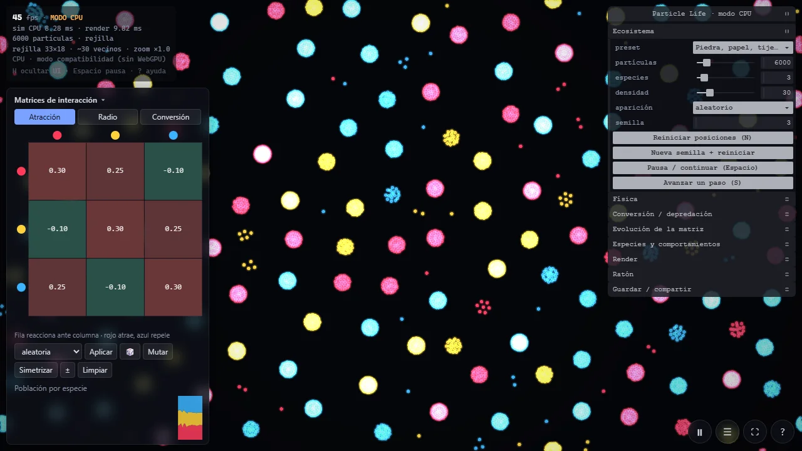

# Problemas y preguntas

## Veo «MODO CPU»

La app no ha podido usar WebGPU y funciona con el motor de respaldo. Pulsa <kbd>?</kbd>: la ayuda muestra
el motivo exacto que dio el navegador.

<figure>
  
  <figcaption>El modo CPU tiene las mismas reglas, con menos partículas y sin bloom.</figcaption>
</figure>

Soluciones, de más a menos habitual:

1. **Actualiza el navegador.** WebGPU está en Chrome y Edge desde la versión 113, en Safari 26 y en Firefox 141 (Windows).
2. **Activa la aceleración por hardware.** Chrome/Edge: *Configuración → Sistema → «Usar aceleración gráfica
   cuando esté disponible»* y reinicia el navegador.
3. **Portátil con dos GPU:** en *Windows → Configuración → Pantalla → Gráficos*, asigna el navegador a
   *Alto rendimiento*.
4. **Linux:** en Chrome puede hacer falta activar `chrome://flags/#enable-unsafe-webgpu` y Vulkan.
5. **Comprueba `chrome://gpu`**: si WebGPU aparece como *Disabled* o *Software only*, tu driver está en la
   lista de bloqueo del navegador; actualizar el driver de la GPU suele resolverlo.

Si añadiste `?cpu` a la URL, el modo CPU es forzado: quítalo.

## Va lento

- Mira el HUD: si `sim GPU` es bajo pero los fps también, el límite es el render; baja *halo*, desactiva el
  bloom o reduce la ventana.
- Reduce *partículas* o *pasos / frame*.
- Comprueba que *algoritmo* es `rejilla`. La fuerza bruta es O(N²) y sólo sirve para comparar.
- Un *radio máx.* muy grande con mucha *densidad* aumenta los vecinos por partícula (`~N vecinos` en el HUD).

Más detalles en [Rendimiento](../referencia/rendimiento).

## La simulación explota o todo colapsa

Mira la tabla *Si algo sale mal* en [Recetas](./recetas#si-algo-sale-mal). En resumen: menos `dt` o
*fuerza* si explota; más *repulsión* o *β* si colapsa.

## Se perdió el dispositivo GPU

El driver reinició la GPU (cambio de GPU en portátiles, suspensión, otra app que acapara memoria).
Recarga la página. Si pasa a menudo con muchas partículas, baja la cantidad.

## El enlace compartible no restaura mi mundo

- Copia el enlace **completo**, incluida la parte desde `#c=`; algunos chats lo recortan.
- Dentro del visor de Artifacts de claude.ai los enlaces no conservan el estado: usa *Exportar JSON*.

## Preguntas frecuentes

### ¿Se guarda algo en un servidor?

No. Todo corre en tu navegador. Los enlaces llevan la configuración en el `#`, que el navegador no envía,
y los guardados viven en `localStorage`.

### ¿Por qué cada vez que pulso N sale distinto?

<kbd>N</kbd> recoloca las partículas con la misma semilla; las pequeñas diferencias de orden en la GPU
(sumas en paralelo) hacen que la evolución diverja con el tiempo, como en cualquier sistema caótico.

### ¿Puedo usarlo en una exposición o como salvapantallas?

Sí: <kbd>H</kbd> + <kbd>F</kbd> y activa la *deriva continua* para que cambie solo. La licencia MIT
permite cualquier uso, también comercial.

### ¿Cómo informo de un fallo?

Abre un [issue](https://github.com/jossseluuu/particleLife/issues/new/choose) con el navegador, la GPU que
aparece en el HUD y, si puedes, un enlace compartible del mundo.
